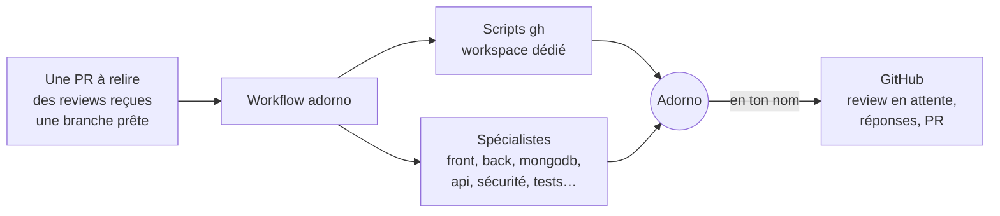
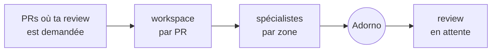
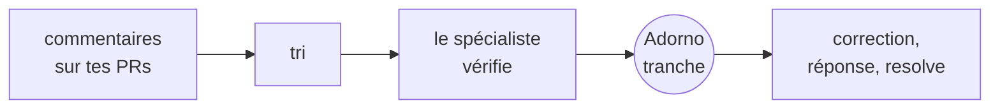
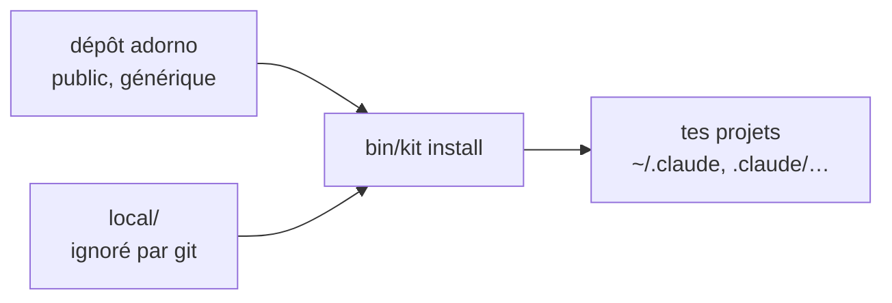

# adorno

**Adorno est un agent qui travaille comme toi.** Il relit les PRs qu'on te demande, répond aux reviews que tu reçois et
ouvre tes PRs, avec ton exigence, tes priorités et ta façon d'écrire. Derrière lui, des spécialistes et des scripts
font le travail : l'analyse du code, les corrections, les échanges avec GitHub. Adorno ne cherche pas les problèmes, il
juge ceux que les spécialistes remontent, revérifie chaque point dans le code, tranche, puis écrit en ton nom.

Le dépôt est un setup d'agents portable : écrit une fois, installé partout (Claude Code, Codex, Gemini CLI). Il est
public et générique. Ce qui fait d'Adorno *ton* agent (ton identité, ton profil, ta voix, ta vision, tes repos, les
droits que tu lui donnes) reste chez toi, dans un dossier ignoré par git.



## Ce qu'Adorno fait pour toi

| Tu lances | Ce qui se passe | Ce qui part sur GitHub par défaut |
| --- | --- | --- |
| `workflow:review:requested` | toutes les PRs où ta review est demandée : un workspace par PR, les spécialistes des zones touchées, puis Adorno | une review **en attente** par PR, que tu relis et soumets |
| `workflow:review:received` | toutes tes PRs : chaque commentaire vérifié par le spécialiste du sujet, corrigé si besoin, puis Adorno tranche et répond | rien en `draft` (défaut) ; tout en `auto` |
| `workflow:pr:open` | la porte de revue sur ta branche (aucun 🔴 ni 🟠 non réglé), puis la PR décrite dans ta voix | la PR |
| `workflow:feature:build` | de la demande à la PR prête : spec, plan en tranches, agents par type de commit, QA avec captures, revue, PR, suivi | la PR, que tu merges |
| `workflow:pr:impact <repo>` | les PRs que tu as mergées : depuis leur déploiement, utilisation, erreurs, temps de réponse et ressources comparés avant / après dans toutes les sources disponibles | un rapport d'impact en commentaire de chaque PR |
| `workflow:slack:mentions` | chaque fois que tu es mentionné : l'analyse du problème et un brouillon de réponse dans ta voix | rien : un message **à toi seul**, avec le lien vers la conversation |
| `workflow:slack:watch <règle>` | les messages d'un canal qui correspondent à une règle (mots ou regex, période, maximum) déclenchent l'action que tu as choisie | rien : un compte rendu à toi seul |
| `workflow:notion:assigned` | les documents Notion qui te sont assignés : l'agent ou le workflow adapté à chacun | rien sur Notion : un compte rendu à toi seul |

Adorno est **la dernière étape** de chaque workflow qui produit quelque chose en ton nom.

Les reviews qu'on te demande :



Les reviews que tu reçois :



**Garde-fous** : reviews en attente par défaut ; réponses en brouillon par défaut ; jamais d'`APPROVE` automatique ;
jamais de merge ni de push forcé ; un refus ou ce qui touche une personne ne part jamais sans toi ; chaque repo a un
plafond de droits que tu fixes.

## Démarrer

Prérequis : [uv](https://docs.astral.sh/uv/) (`brew install uv`), `gh` authentifié, `jq`.

```sh
git clone https://github.com/<owner>/adorno && cd adorno
cp -r local.example local          # ta couche personnelle, ignorée par git
bin/kit install --global           # ~/.claude, ~/.agents, ~/.gemini : partout sur la machine
```

Puis, dans Claude Code, demande à Adorno de te connaître : **« lance le skill adorno-setup »**. Le mode `profile`
t'interroge (une question à la fois, en lisant tes vraies reviews sur GitHub pour ta voix) et écrit ton profil dans
`local/`. Le mode `repo` déclare un repo ou tout un workspace, avec ses relecteurs, son contexte et ses droits.

Le guide complet, de l'installation aux droits par repo : **[docs/setup.md](docs/setup.md)**.

Le plugin public donne les agents, les skills et les commandes, sans les instructions ni ta couche personnelle :
les workflows GitHub y refusent tout repo (aucun n'est déclaré). Il sert à essayer ; pour travailler, installe avec
`bin/kit install --global` :

```
/plugin marketplace add <owner>/adorno
/plugin install adorno@adorno
```

## Ta couche personnelle



```
local/
  adorno.yaml   toi, tes presets, workspaces et repos : relecteurs, équipe, contexte, droits, voix, vision
  vision.md     ta vision : appliquée par-dessus tous les agents
  src/          ton profil, ta voix, ton résumé, tes agents et skills privés
```

- **Partager** une config entre repos (`presets` + `use:`) ou l'appliquer à **tout un workspace** (globs GitHub
  `acme/*` ou dossiers locaux).
- **Droits par repo** : un plafond (`max_level`), des actions GitHub refusées (`permissions.deny`), des règles natives
  de Claude Code (`permissions.claude`, écrites dans le repo à l'install).
- **Voix** : ta charte d'écriture par canal, et des réglages par repo (ton, formalité, longueur, emoji…).
- **Vision** : quelques principes qui priment sur tous les agents ; seules les règles d'un repo priment sur son code.
- **Slack et Notion** : tes règles de surveillance, les canaux où tes mentions comptent, les bases Notion suivies.
- **Modèles** : chaque agent sur le modèle qui suffit à sa tâche (`fast`, `balanced`, `deep`, traduits pour Claude
  Code et Gemini), un modèle précis par agent, ou une route vers OpenRouter, OpenAI, Google ou tes propres modèles ;
  par repo si besoin.
- `bin/kit conf owner/repo` montre ce qu'un repo résout et d'où vient chaque réglage.

Le dépôt public ne contient aucun profil : seulement des modèles, dans `local.example/`.

## Sous le capot

| Famille | Agents | Commits |
| --- | --- | --- |
| — | `agent:adorno` : parle et décide en ton nom, dernière étape des workflows | aucun |
| `core` | `intake`, `router`, `planner`, `triage`, `analyst` (analyse d'une conversation ou d'un document) | aucun |
| `review` | `code`, `security`, `tests` (étendent les agents d'addy), `perf`, `ponytail`, par zone : `front`, `back`, `mongodb`, `api`, et après merge : `impact` | aucun, lecture seule |
| `feat` | `front`, `back`, `api` | `feat` |
| `fix` | `investigate` (lecture seule), `patch` | `fix` |
| `perf` | `mongodb`, `nodejs` | `perf`, mesures avant/après |
| `refactor` | `simplify` | `refactor` |
| `test` | `unit`, `e2e` (Playwright : captures, vidéo, traces) | `test` |
| `ci` | `debug` | `ci` |
| `chore` | `repo` | `chore` |

| Workflow | Fait |
| --- | --- |
| `workflow:spec:new` | discussion, challenge, spec et droits avec `agent:core:intake` |
| `workflow:feature:build` | de la demande à la PR prête |
| `workflow:issue:fix` | d'une issue à la PR « Fixes #n » |
| `workflow:pr:open` | porte de revue, puis la PR |
| `workflow:pr:review` | une PR d'un collègue : workspace, spécialistes, passe finale d'Adorno ; `report`, `pending`, `auto` |
| `workflow:review:requested` | toutes les PRs où ta review est demandée |
| `workflow:review:received` | toutes les reviews reçues sur tes PRs ; `report`, `draft`, `auto` |
| `workflow:pr:watch` | CI rouge et nouveaux commentaires en boucle, jusqu'à « prête à merger » |
| `workflow:pr:status` | l'état de toutes tes PRs |
| `workflow:pr:impact` | l'impact en production des PRs que tu as mergées, en commentaire de chacune ; `report`, `comment` |
| `workflow:ci:red` | diagnostic d'une CI rouge, une relance si flaky, sinon correction |
| `workflow:repo:onboard` | prépare un repo pour les agents, puis le déclare avec `adorno-setup` |
| `workflow:profile:learn` | les ajustements de ton profil relevés pendant le travail (tech, produit, code, méthode, voix), un par un, avec leurs preuves ; n'écrit que ce que tu valides |
| `workflow:slack:mentions` | tes mentions Slack : analyse et brouillon de réponse, envoyés à toi seul |
| `workflow:slack:watch` | une règle de surveillance d'un canal Slack, et son action sur chaque message qui correspond |
| `workflow:notion:assigned` | les documents Notion qui te sont assignés, et l'agent qui convient à chacun |

**Skills** : `adorno-setup`, `adorno-profile`, `adorno-voice`, `adorno-learn` (le profil qui apprend de tes
corrections), `adorno-github` (scripts `gh` testés sans réseau, exécutions et droits), `adorno-watch` (réglages et
mémoire des surveillances Slack et Notion), `adorno-llm` (une tâche envoyée à un modèle compatible OpenAI),
`adorno-run-plan` (dérouler un plan depuis la session), `adorno-commit`, et les skills importés tels quels : [addy/agent-skills](https://skills.addy.ie/) (méthode, de la spec
au déploiement), [ponytail](https://ponytail.dev/) (le moins de code qui marche),
[playwright-cli](https://github.com/microsoft/playwright-cli) et
[webapp-testing](https://github.com/anthropics/skills) (QA navigateur),
[typescript-pro](https://github.com/Jeffallan/claude-skills) (TypeScript avancé).

**Nommage** : `agent:<type>:<spécialité>` (un type de Conventional Commit par famille) et
`workflow:<domaine>:<action>`. Tout ce qui est installé commence par `adorno` : `workflow:review:requested` →
`/adorno-review-requested`, `agent:review:code` → `/adorno-agent-review-code` (sous-agent et commande), `agent:adorno`
→ `/adorno`, et les skills `adorno-*`. Les skills importés (addy, ponytail, Playwright…) gardent leur nom d'origine.

```
src/
  instructions/         → AGENTS.md de chaque projet
  agents/adorno.md      → agent:adorno
  agents/<famille>/     _family.md + <spécialité>.md → agent:<famille>:<spécialité>
  workflows/<domaine>/  <action>.md → workflow:<domaine>:<action>
  skills/               adorno-* (setup, profile, voice, learn, github, watch, llm, run-plan, commit)
repos.yaml              réglages publics par défaut (zones de code, relecteurs par zone, droits)
local.example/          modèle de ta couche personnelle
vendor/                 skills et agents importés (kit import), figés dans kit.lock
dist/                   sorties générées (kit build), plugin Claude Code compris
docs/                   guides
tests/                  tests des scripts adorno-github contre un faux gh
```

## Commandes du kit

```sh
bin/kit check [--dist]       # valide (et vérifie que dist/ est à jour)
bin/kit build                # régénère dist/ et le marketplace (jamais avec local/)
bin/kit list                 # tout ce qui est disponible, avec sa provenance
bin/kit conf [owner/repo]    # les réglages qu'un repo résout
bin/kit new agent fix:flaky  # ou: new workflow ci:flaky, new skill <nom>
bin/kit import [--update]    # skills et agents importés (commits figés dans kit.lock)
bin/kit install PATH|--global|--workspace NOM [--targets claude,codex] [--public-only] [--dry-run]
bin/kit uninstall PATH|--global|--workspace NOM
tests/adorno-github.test.sh     # tests des scripts GitHub, sans réseau
tests/adorno-watch.test.sh   # tests des scripts de surveillance, sans connecteur
tests/adorno-llm.test.sh     # tests de l'envoi à un modèle externe, sans réseau
tests/kit.test.sh            # tests de bin/kit : validation, installation, désinstallation
tests/adorno-setup.test.sh   # tests du setup (source d'adorno, échantillons de voix)
tests/adorno-learn.test.sh   # tests du profil qui apprend
# la CI les lance aussi sur macOS, avec /bin/bash 3.2
```

`kit install` est idempotent, retire ce qui a disparu du kit et ne touche ni tes fichiers ni ceux que tu as modifiés.
Dans un repo, tout ce qu'il installe est ajouté à `.git/info/exclude` (rien ne peut être committé par erreur), il
n'écrit jamais dans un `CLAUDE.md` ou `AGENTS.md` suivi par le repo (Claude reçoit alors `.claude/rules/adorno.md`),
et à côté d'une installation globale (avec ta couche personnelle) il laisse les instructions à celle-ci pour Claude,
Codex et Gemini. Ton registre complet vit dans `~/.adorno/registry.json`, hors de tout repo, en lecture seule ; chaque
installation avec ta couche le réécrit, et les scripts préviennent quand `local/` a changé depuis. Un fichier de
réglages invalide arrête l'installation avant toute écriture.

Quatre barrières séparent une commande d'agent de GitHub (détail dans `docs/setup.md`, étape 4) :

1. **Règles natives** de chaque outil, sur le début de la commande (`git push`, `gh pr comment`…).
2. **Hook de garde** (`guard_bash.py`, pour Claude Code, Codex et Gemini) : il lit la commande comme le shell
   (`git -C x push`, `bash -c '…'`, `$( … )`, alias git, `python3 -c`, scripts locaux lancés) ; il bloque tout si
   `python3` manque.
3. **Scripts adorno** : une exécution ouverte par la session (`CLAUDE_CODE_SESSION_ID`), pour les repos qu'elle
   nomme, sous le `max_level` et les `deny` du repo.
4. **GitHub** : ton jeton et tes rulesets. `repo-audit` (lecture seule) dit si la branche par défaut exige une PR et
   si ton jeton est trop large.

Dans un repo installé, les barrières 1 et 2 refusent ; avec `--global` (valable dans tous tes projets), elles te
demandent confirmation.

| | Skills | Agents | Workflows | Instructions |
| --- | --- | --- | --- | --- |
| **Claude Code** | `.claude/skills/` | `.claude/agents/` + une commande chacun | `.claude/commands/` | `CLAUDE.md` → `@AGENTS.md` |
| **Codex** | `.agents/skills/` | skill de rôle | skill | `AGENTS.md` |
| **Gemini CLI** | `.gemini/skills/` | `.gemini/agents/` + une commande chacun | `.gemini/commands/*.toml` | `GEMINI.md` → `@AGENTS.md` |

Copilot et Cursor sont décrits dans `adapters/targets.yaml` mais pas encore testés en conditions réelles.
