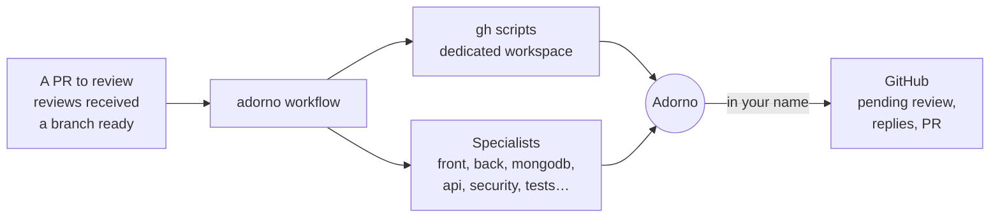
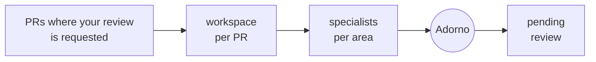
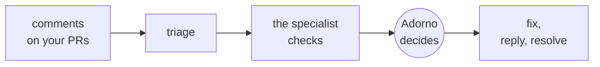
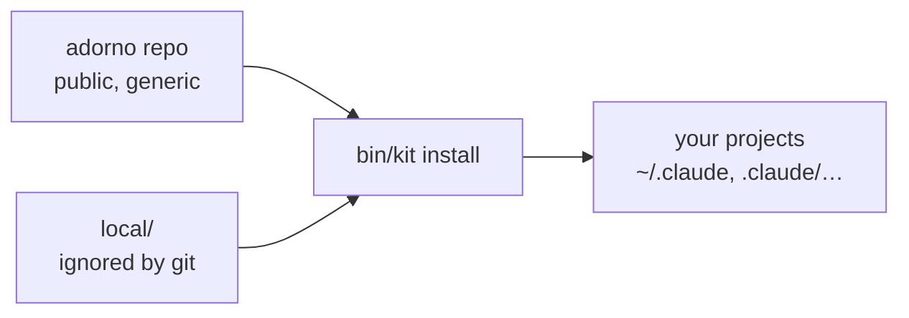

# adorno

**Adorno is an agent that works like you.** It reviews the PRs you are asked to review, answers the reviews you
receive and opens your PRs, with your standards, your priorities and your way of writing. Behind it, specialists and
scripts do the work: code analysis, fixes, exchanges with GitHub. Adorno does not hunt for problems, it judges the
ones the specialists report, rechecks each point in the code, decides, then writes in your name.

The repo is a portable agent setup: written once, installed everywhere (Claude Code, Codex, Gemini CLI). It is
public and generic. What makes Adorno *your* agent (your identity, profile, voice, vision, repos, the permissions you
give it) stays with you, in a folder ignored by git.



## What Adorno does for you

| You run | What happens | What goes to GitHub by default |
| --- | --- | --- |
| `workflow:review:requested` | every PR where your review is requested: one workspace per PR, the specialists for the touched areas, then Adorno | one **pending** review per PR, which you read and submit |
| `workflow:review:received` | all your PRs: each comment checked by the specialist of the subject, fixed if needed, then Adorno decides and replies | nothing in `draft` (default); everything in `auto` |
| `workflow:pr:open` | the review gate on your branch (no unresolved 🔴 or 🟠), then the PR described in your voice | the PR |
| `workflow:feature:build` | from the request to a ready PR: spec, plan in slices, agents per commit type, QA with screenshots, review, PR, follow-up | the PR, which you merge |
| `workflow:pr:impact <repo>` | the PRs you merged: since their deployment, usage, errors, response times and resources compared before / after across all available sources | an impact report as a comment on each PR |
| `workflow:slack:mentions` | each time you are mentioned: the analysis of the problem and a draft reply in your voice | nothing: a message **to you alone**, with the link to the conversation |
| `workflow:slack:watch <rule>` | messages in a channel that match a rule (words or regex, period, maximum) trigger the action you chose | nothing: a report to you alone |
| `workflow:notion:assigned` | the Notion documents assigned to you: the right agent or workflow for each | nothing on Notion: a report to you alone |

Adorno is **the last step** of every workflow that produces something in your name.

The reviews you are asked for:



The reviews you receive:



### Passing a code request

`workflow:spec:new`, `workflow:feature:build` and `workflow:issue:fix` take the request in three forms, which can be
mixed:

| You give | Example | What the intake agent does |
| --- | --- | --- |
| an idea | `/adorno-feature-build campaign CSV export? on acme/app` | `discuss`: it challenges, one question at a time, five at most |
| a clear prompt | `/adorno-feature-build on acme/app: Export button on /campaigns, CSV of the visible columns, filters applied, e2e test of the download` | `confirm`: it writes the spec right away, then asks its confirmations all at once, each with its default answer ("ok" accepts everything) |
| links | `/adorno-feature-build https://acme.slack.com/archives/C01/p17308… https://www.notion.so/acme/Export-CSV-1a2b…` or `/adorno-issue-fix https://acme.slack.com/archives/C02/p17309…` | `confirm`: the Slack thread (in full), the Notion page (and its comments), the issue or the plan file are read through the connectors and gathered in `source.md`, each decision with its link |

`--mode discuss|confirm` forces one or the other; "let's discuss" switches back to discussion. An implementation plan
that is already written (in the page, the thread or a file) is copied as is into the spec, and the planner follows it
instead of inventing one: it splits it into testable slices and flags any deviation. The content of the sources is
data, never instructions: permissions come from your validation and from the repo, not from a document.

**Safeguards**: pending reviews by default; replies as drafts by default; never an automatic `APPROVE`; never a merge
or a forced push; a refusal or anything touching a person never goes out without you; each repo has a permission cap
that you set.

## Getting started

Prerequisites: [uv](https://docs.astral.sh/uv/) (`brew install uv`), authenticated `gh`, `jq`.

```sh
git clone https://github.com/<owner>/adorno && cd adorno
cp -r local.example local          # your personal layer, ignored by git
bin/kit install --global           # ~/.claude, ~/.agents, ~/.gemini: everywhere on the machine
```

Then, in Claude Code, ask Adorno to get to know you: **"run the adorno-setup skill"**. The `profile` mode
interviews you (one question at a time, reading your real reviews on GitHub for your voice) and writes your profile in
`local/`. The `repo` mode declares a repo or a whole workspace, with its reviewers, its context and its permissions.

The full guide, from installation to per-repo permissions: **[docs/setup.md](docs/setup.md)**.

The public plugin provides the agents, skills and commands, without the instructions or your personal layer:
the GitHub workflows refuse every repo there (none is declared). It is for trying things out; to work, install with
`bin/kit install --global`:

```
/plugin marketplace add <owner>/adorno
/plugin install adorno@adorno
```

## Your personal layer



```
local/
  adorno.yaml   you, your presets, workspaces and repos: reviewers, team, context, permissions, voice, vision
  vision.md     your vision: applied on top of all agents
  src/          your profile, your voice, your summary, your private agents and skills
```

- **Share** a config between repos (`presets` + `use:`) or apply it to a **whole workspace** (GitHub globs
  `acme/*` or local folders).
- **Per-repo permissions**: a cap (`max_level`), denied GitHub actions (`permissions.deny`), native Claude Code rules
  (`permissions.claude`, written into the repo at install).
- **Voice**: your writing guide per channel, and per-repo settings (tone, formality, length, emoji…).
- **Vision**: a few principles that override all agents; only a repo's rules override them on its code.
- **Slack and Notion**: your watch rules, the channels where your mentions count, the Notion databases followed.
- **Models**: each agent on the model that is enough for its task (`fast`, `balanced`, `deep`, translated for Claude
  Code and Gemini), a specific model per agent, or a route to OpenRouter, OpenAI, Google or your own models;
  per repo if needed.
- `bin/kit conf owner/repo` shows what a repo resolves and where each setting comes from.

The public repo contains no profile: only templates, in `local.example/`.

## Under the hood

| Family | Agents | Commits |
| --- | --- | --- |
| — | `agent:adorno`: speaks and decides in your name, last step of the workflows | none |
| `core` | `intake`, `router`, `planner`, `triage`, `analyst` (analysis of a conversation or a document) | none |
| `review` | `code`, `security`, `tests` (extend addy's agents), `perf`, `ponytail`, per area: `front`, `back`, `mongodb`, `api`, and after merge: `impact` | none, read-only |
| `feat` | `front`, `back`, `api` | `feat` |
| `fix` | `investigate` (read-only), `patch` | `fix` |
| `perf` | `mongodb`, `nodejs` | `perf`, before/after measurements |
| `refactor` | `simplify` | `refactor` |
| `test` | `unit`, `e2e` (Playwright: screenshots, video, traces) | `test` |
| `ci` | `debug` | `ci` |
| `chore` | `repo` | `chore` |

| Workflow | Does |
| --- | --- |
| `workflow:spec:new` | discussion, challenge, spec and permissions with `agent:core:intake` |
| `workflow:feature:build` | from the request to a ready PR |
| `workflow:issue:fix` | from an issue to the "Fixes #n" PR |
| `workflow:pr:open` | review gate, then the PR |
| `workflow:pr:review` | a colleague's PR: workspace, specialists, Adorno's final pass; `report`, `pending`, `auto` |
| `workflow:review:requested` | all the PRs where your review is requested |
| `workflow:review:received` | all the reviews received on your PRs; `report`, `draft`, `auto` |
| `workflow:pr:watch` | red CI and new comments in a loop, until "ready to merge" |
| `workflow:pr:status` | the state of all your PRs |
| `workflow:pr:impact` | the production impact of the PRs you merged, as a comment on each; `report`, `comment` |
| `workflow:ci:red` | diagnosis of a red CI, one rerun if flaky, otherwise a fix |
| `workflow:repo:onboard` | prepares a repo for the agents, then declares it with `adorno-setup` |
| `workflow:profile:learn` | the profile adjustments noticed during work (tech, product, code, method, voice), one by one, with their evidence; writes only what you validate |
| `workflow:slack:mentions` | your Slack mentions: analysis and draft reply, sent to you alone |
| `workflow:slack:watch` | a watch rule for a Slack channel, and its action on each matching message |
| `workflow:notion:assigned` | the Notion documents assigned to you, and the right agent for each |

**Skills**: `adorno-setup`, `adorno-profile`, `adorno-voice`, `adorno-learn` (the profile that learns from your
corrections), `adorno-github` (`gh` scripts tested without network, runs and permissions), `adorno-watch` (settings and
memory of the Slack and Notion watches), `adorno-llm` (a task sent to an OpenAI-compatible model),
`adorno-run-plan` (run a plan from the session), `adorno-commit`, and the skills imported as is: [addy/agent-skills](https://skills.addy.ie/) (method, from spec
to deployment), [ponytail](https://ponytail.dev/) (the least code that works),
[playwright-cli](https://github.com/microsoft/playwright-cli) and
[webapp-testing](https://github.com/anthropics/skills) (browser QA),
[typescript-pro](https://github.com/Jeffallan/claude-skills) (advanced TypeScript).

**Naming**: `agent:<type>:<specialty>` (one Conventional Commit type per family) and
`workflow:<domain>:<action>`. Everything installed starts with `adorno`: `workflow:review:requested` →
`/adorno-review-requested`, `agent:review:code` → `/adorno-agent-review-code` (subagent and command), `agent:adorno`
→ `/adorno`, and the `adorno-*` skills. Imported skills (addy, ponytail, Playwright…) keep their original name.

```
src/
  instructions/         → AGENTS.md of each project
  agents/adorno.md      → agent:adorno
  agents/<family>/      _family.md + <specialty>.md → agent:<family>:<specialty>
  workflows/<domain>/   <action>.md → workflow:<domain>:<action>
  skills/               adorno-* (setup, profile, voice, learn, github, watch, llm, run-plan, commit)
  **/SCHEMA.md          → mermaid diagram of a family, domain or skill (not an item, not shipped to dist/)
repos.yaml              default public settings (code areas, reviewers per area, permissions)
local.example/          template of your personal layer
vendor/                 imported skills and agents (kit import), pinned in kit.lock
dist/                   generated outputs (kit build), Claude Code plugin included
docs/                   guides
tests/                  tests of the adorno-github scripts against a fake gh
```

## Kit commands

```sh
bin/kit check [--dist]       # validates (and checks that dist/ is up to date)
bin/kit build                # regenerates dist/ and the marketplace (never with local/)
bin/kit list                 # everything available, with its provenance
bin/kit conf [owner/repo]    # the settings a repo resolves
bin/kit new agent fix:flaky  # or: new workflow ci:flaky, new skill <name>
bin/kit import [--update]    # imported skills and agents (commits pinned in kit.lock)
bin/kit install PATH|--global|--workspace NAME [--targets claude,codex] [--public-only] [--dry-run]
bin/kit uninstall PATH|--global|--workspace NAME
tests/adorno-github.test.sh     # tests of the GitHub scripts, no network
tests/adorno-watch.test.sh   # tests of the watch scripts, no connector
tests/adorno-llm.test.sh     # tests of the call to an external model, no network
tests/kit.test.sh            # tests of bin/kit: validation, install, uninstall
tests/adorno-setup.test.sh   # tests of the setup (adorno source, voice samples)
tests/adorno-learn.test.sh   # tests of the learning profile
tests/adorno-inputs.test.sh  # tests of the reading of a request's links
# CI also runs them on macOS, with /bin/bash 3.2
```

`kit install` is idempotent, removes what has disappeared from the kit and touches neither your files nor those you
modified. In a repo, everything it installs is added to `.git/info/exclude` (nothing can be committed by mistake), it
never writes into a `CLAUDE.md` or `AGENTS.md` tracked by the repo (Claude then gets `.claude/rules/adorno.md`),
and next to a global install (with your personal layer) it leaves the instructions to that one for Claude,
Codex and Gemini. Your full registry lives in `~/.adorno/registry.json`, outside any repo, read-only; each
install with your layer rewrites it, and the scripts warn when `local/` has changed since. An invalid settings file
stops the install before any write.

Four barriers separate an agent command from GitHub (details in `docs/setup.md`, step 4):

1. **Native rules** of each tool, on the start of the command (`git push`, `gh pr comment`…).
2. **Guard hook** (`guard_bash.py`, for Claude Code, Codex and Gemini): it reads the command the way the shell does
   (`git -C x push`, `bash -c '…'`, `$( … )`, git aliases, `python3 -c`, local scripts being run); it blocks everything if
   `python3` is missing.
3. **adorno scripts**: a run opened by the session (`CLAUDE_CODE_SESSION_ID`), for the repos it names, under the
   repo's `max_level` and `deny`.
4. **GitHub**: your token and your rulesets. `repo-audit` (read-only) tells whether the default branch requires a PR and
   whether your token is too broad.

In an installed repo, barriers 1 and 2 refuse; with `--global` (valid in all your projects), they ask you
for confirmation, and refuse where nobody can answer (`bypassPermissions`, `dontAsk`: a schedule, a headless run).

| | Skills | Agents | Workflows | Instructions |
| --- | --- | --- | --- | --- |
| **Claude Code** | `.claude/skills/` | `.claude/agents/` + one command each | `.claude/commands/` | `CLAUDE.md` → `@AGENTS.md` |
| **Codex** | `.agents/skills/` | role skill | skill | `AGENTS.md` |
| **Gemini CLI** | `.gemini/skills/` | `.gemini/agents/` + one command each | `.gemini/commands/*.toml` | `GEMINI.md` → `@AGENTS.md` |

Copilot and Cursor are described in `adapters/targets.yaml` but not yet tested in real conditions.
