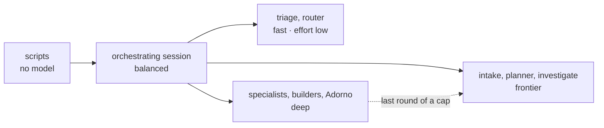

# Models: each step on the model that suffices

A workflow is a chain of steps: scripts, an orchestrating session, and agents. Each step runs on the cheapest model
that does it well, measured by the **cost of a finished task, not the price of a token**. A model too small for its
step costs more in rework than it saves.

Source: [Which Claude model should you build with?](https://claude.dev/blog/which-claude-model-should-you-build-with/).
The setting of each item is in its frontmatter (`model:`, `effort:`). Change it per repo in `local/adorno.yaml` ›
`models` ([setup.md › Models](setup.md#9-models-and-providers)).

## The four tiers

| Tier | Claude Code | In adorno |
| --- | --- | --- |
| `fast` | haiku | classify, route, format the output of a script: `core:triage`, `core:router`, `workflow:pr:status` |
| `balanced` | sonnet | the session that orchestrates a workflow: runs the scripts, delegates, merges by script, never judges |
| `deep` | opus | every agent that judges, investigates, reviews or writes code (the default) |
| `frontier` | fable | the thinking phases: frame the spec (`core:intake`), slice the plan (`core:planner`), find a root cause (`fix:investigate`); the last round of a capped loop |

`inherit` keeps the session's model. Gemini CLI and Codex run everything on the session's model unless
`models.tiers.<tool>` maps the tiers (Codex has no subagents).

## The rules

1. **Scripts first.** Listing, filtering, waiting, merging reviews and publishing cost no tokens. They stay in
   `adorno-github`, `adorno-watch` and the other skills' scripts, never in a model.
2. **The session orchestrates, agents judge.** A workflow's session runs on `balanced`: it calls scripts, starts
   agents and keeps only their deliverables (`review.json`, `triage.json`, verdicts), never the raw reading. Any
   verdict, diagnosis, plan or code goes to an agent, the only way it runs on its own model. Exceptions:
   - `workflow:pr:status` is a script and a table, so it runs on `fast`;
   - `workflow:profile:learn` delegates nothing (the session itself proposes the sentences of your profile), so it
     runs on `deep`.
3. **A nested workflow runs in its caller's session.** `pr:watch` runs `ci:red` and `review:received` in its own
   session, and `slack:watch` can run a workflow action. A workflow that launches others is therefore never on
   `fast`: the guide advises against small models for long agentic loops.
4. **Thinking phases on `frontier`.** Framing a request, slicing it into vertical slices and finding a bug's root
   cause each happen once per run, and every later step depends on them: the guide gives Fable architecture planning,
   major refactors and work where Opus at `high` falls short.
5. **Effort before tier.** Effort is the finer dial. `low` for classification and formatting (triage, router,
   pr:status); the model's default everywhere else. Past `high`, the next tier at a lower effort is usually cheaper
   for the same result.
6. **Climb only on failure.** Every capped loop starts each agent on its own tier. A failed round goes again at
   `effort: high`, and the last round runs one tier up (`deep` → `frontier`), within the same cap
   ([`adorno-run-plan` › Loops](../src/skills/adorno-run-plan/SKILL.md)). An agent on an external route does not
   climb. This is the guide's "run cheap, re-run only the failures higher" pattern.
7. **Lean context for expensive models.** An agent receives the previous deliverable and the files of its area, never
   the history. Verbose reading (logs, threads, full documents) happens in the agent that needs it, not in the
   session. Exception: the Slack and Notion connectors belong to the session alone (agents have no MCP tools), so
   `notion:assigned`, `slack:mentions` and `slack:watch` read the document or thread in the session and pass it to
   the agent.

**A deliberate departure from the guide.** The guide puts well-scoped coding (bug fix, spec-driven feature) and
repeated reviews on Sonnet. The owner of this setup chose Opus for every agent that writes or judges code
(`feat:*`, `fix:patch`, `test:*`, `refactor:simplify`, `review:*`). That costs more per token on building and
reviewing (the guide's price table). To go back to the guide on a repo, set `models.agents.<id>: balanced` for those agents.

## Step by step

| Workflow | Session | Steps (agent → tier) |
| --- | --- | --- |
| `ci:red` | balanced | `ci:debug` → deep; the designated fixer → deep; `pr:ship` |
| `feature:build` | balanced | `spec:new` (`intake` → frontier); `router` → fast; `planner` → frontier; `feat:*`, `test:e2e` → deep (3 rounds, the 3rd on frontier); reviewers → deep (2 rounds); `pr:ship`; `pr:watch` |
| `issue:fix` | balanced | `fix:investigate` → frontier; `fix:patch` → deep; `pr:ship`; `pr:watch` |
| `notion:assigned` | balanced | the session reads each document (it alone has the Notion connector); `router` → fast; `core:analyst` → deep, or the chosen workflow |
| `pr:impact` | balanced | `review:impact` → deep, per PR in parallel; `adorno` → deep |
| `pr:open` | balanced | `adorno` → deep (title and description) |
| `pr:review` | balanced | the area's `review:*` → deep, in parallel; `review-merge` (script); `adorno` → deep |
| `pr:ship` | balanced | area reviewers and `adorno` → deep; fixers → deep (2 rounds, the 2nd on frontier) |
| `pr:status` | fast, effort low | `pr-status` (script) |
| `pr:watch` | balanced | `ci:red`, `review:received` (nested) |
| `profile:learn` | deep | none: the session proposes, you validate each point |
| `repo:onboard` | balanced | `chore:repo` → deep; `pr:ship` |
| `review:received` | balanced | `triage` → fast, effort low; specialists (consult) → deep; `adorno` → deep; fixers → deep (3 rounds, the 3rd on frontier); `pr:ship` |
| `review:requested` | balanced | the steps of `pr:review` per PR |
| `slack:mentions` | balanced | `core:analyst` → deep; `adorno` → deep (draft reply) |
| `slack:watch` | balanced | the rule's action: an agent on its own tier, or a workflow in this session |
| `spec:new` | balanced | `core:intake` → frontier |

## Measuring

Before changing a tier for good, take a real task with a check (a test that passes, a review that holds), run it on
both models (`/model`), and compare `/usage`. Keep a mix of models only if it beats the best single model on cost per
finished task.

## Known limits

- When a workflow runs inside another (rule 3), whether Claude Code applies the nested workflow's own `model:` is not
  verified. Assume the caller's session model.
- The prompt cache belongs to the model that wrote it: a session that switches model (a workflow whose `model:`
  differs from yours) re-reads its context at the new model's price. Start a workflow in a fresh session when you can.
