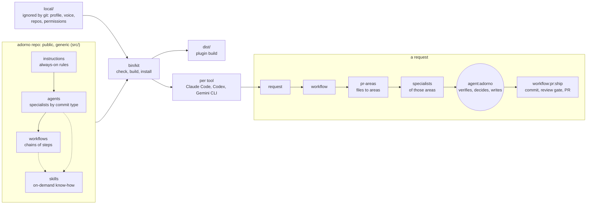

# adorno in one page

Read this first if you do not know adorno. It explains how the pieces fit; [README](../README.md) says what adorno
does for you and [setup.md](setup.md) installs and configures it.

## The four layers

All of them live in `src/` and are written in a neutral format that `bin/kit` translates for each tool. Counts come
from `bin/kit list`.

| Layer | Where | Count | The rule that matters most |
| --- | --- | --- | --- |
| Instructions | `src/instructions/NN-topic.md`, concatenated in name order | 2 files | The repo's own rules (`CLAUDE.md`, `.claude/rules/`) win over everything on its code. |
| Agents | `src/agents/<type>/<specialty>.md`, plus `src/agents/adorno.md` | 32 | An agent of a commit-type family only produces commits of that type; `core` and `review` never commit. |
| Workflows | `src/workflows/<domain>/<action>.md` | 17 | Every workflow that touched code ends with `workflow:pr:ship`. |
| Skills | `src/skills/<name>/SKILL.md`, with `scripts/` and `references/` | 42 | All GitHub access goes through the scripts of `adorno-github`, never an ad hoc command. |

- **Agents** are `agent:<type>:<specialty>` with a Conventional Commit type, or `core` (frame, triage) and `review`
  (judge). `agent:adorno` sits outside the families: it speaks and decides in the owner's name and is the last step of
  every workflow that publishes something.
- **Workflows** are the entry points (`/adorno-pr-open`, `/adorno-feature-build`...). Only the session running a
  workflow starts agents; an agent never starts another one.
- **Skills** hold the deterministic parts: scripts that return JSON, with exit codes documented in
  `src/skills/adorno-github/SKILL.md`.
- Each family and domain folder has a `SCHEMA.md` with its mermaid diagrams; they are not shipped.

## The personal layer

`local/` is ignored by git and holds everything about a real person or repo: identity, profile, voice, vision, repos,
permissions. The public repo only has the templates in `local.example/`. `bin/kit install` merges both and writes the
result for each tool; `bin/kit conf owner/repo` shows what a repo resolves to. `dist/` is generated: never edit it by
hand. See [setup.md](setup.md#1-install).

## Permission levels

A run's level is set when it is framed and never widens: a need beyond it stops the run. Source:
`src/instructions/10-orchestration.md`.

| Level | Allows | Forbids |
| --- | --- | --- |
| L0 | read, search, run tests and linters | any write |
| L1 | edit files in a worktree | commit, network beyond documentation |
| L2 | commit and push on a working branch or on the branch of one of your PRs (never forced) | PRs, GitHub comments |
| L3 | open and update a PR, reply, resolve, re-request a review | merge, default branch |
| L4 | merge, tag, deploy | never automatic: always you |

## A run

A workflow that writes to GitHub opens a run (`run-begin`, with a workflow, a mode, a level and the repos it
touches) and closes it with `run-end`. The granted right lives in a file, so without an open run every write script
refuses (L0). A run also writes its state in `.agent-run/<id>/` in the repo.

## Where next

- [README](../README.md): what adorno does for you, and the safeguards.
- [setup.md](setup.md): install, profile, repos, permissions, voice, Slack and Notion, models.
- [models.md](models.md): which model each step runs on.
- [decisions/](decisions/): why things are the way they are.
