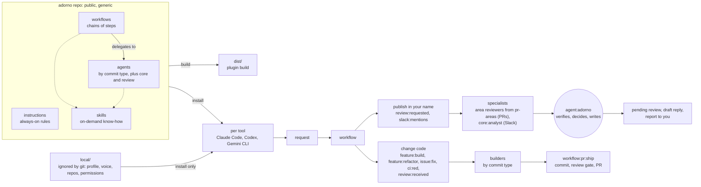

# adorno in one page

Read this first if you do not know adorno. It explains how the pieces fit; [README](../README.md) says what adorno
does for you and [setup.md](setup.md) installs and configures it.

`bin/kit` (`check`, `build`, `install`) turns the repo into the tool's files. `build` never reads `local/`, so `dist/` stays public;
`check` and `install` do. In `workflow:pr:ship` the review gate is itself `pr-areas`, the area reviewers, then `agent:adorno`.

## The four layers

Written in a neutral format that `bin/kit` translates for each tool. `bin/kit list` gives the current inventory.

| Layer | Where | The rule that matters most |
| --- | --- | --- |
| Instructions | `src/instructions/NN-topic.md`, concatenated in name order | The repo's own rules (`CLAUDE.md`, `.claude/rules/`) win over everything on its code. |
| Agents | `src/agents/<type>/<specialty>.md`, plus `src/agents/adorno.md` | An agent of a commit-type family only produces commits of that type; `core` and `review` never commit. |
| Workflows | `src/workflows/<domain>/<action>.md` | Every workflow that touched code ends with `workflow:pr:ship`. |
| Skills | `src/skills/<name>/SKILL.md` (own) and `vendor/` (imported) | GitHub access goes through the `adorno-github` scripts, except the repo's own commit and PR skills inside `workflow:pr:ship`, at the run's level. |

- **Agents** are `agent:<type>:<specialty>` with a Conventional Commit type, or `core` (frame, plan, route, triage) and
  `review` (judge). `agent:adorno` sits outside the families: it speaks and decides in the owner's name and is the
  last step of every workflow that publishes something.
- **Workflows** are the entry points (`/adorno-pr-open`, `/adorno-feature-build`...). Only the session running a
  workflow starts agents; an agent never starts another one.
- **Skills** are on-demand know-how; some carry scripts (JSON on stdout, exit codes in
  `src/skills/adorno-github/SKILL.md`) for the deterministic parts. Most are imported from other repos
  (`kit.yaml` `imports:`, fetched by `bin/kit import`, pinned in `kit.lock`); an imported item is never edited in
  `vendor/`, a local file with `extends:` overrides it.

## The personal layer and the levels

`local/` is ignored by git and holds everything about a real person or repo; the public repo only has the templates in
`local.example/`. `bin/kit conf owner/repo` shows what a repo resolves to. `dist/` is generated: never edit it by hand.

Every run has a level from L0 (read) to L4 (merge, never automatic) that never widens, and a workflow that writes to
GitHub opens a run that fixes it. The table is in `src/instructions/10-orchestration.md`, the per-repo cap in
[setup.md](setup.md#4-permissions).

More: [models.md](models.md) (which model each step runs on), [decisions/](decisions/) (why things are the way they are).
