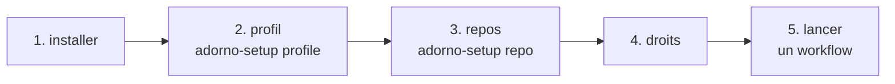
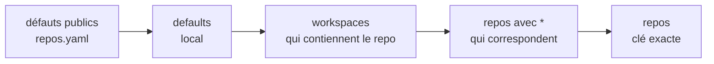
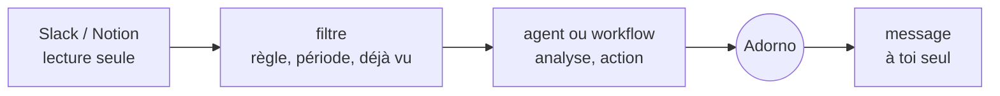
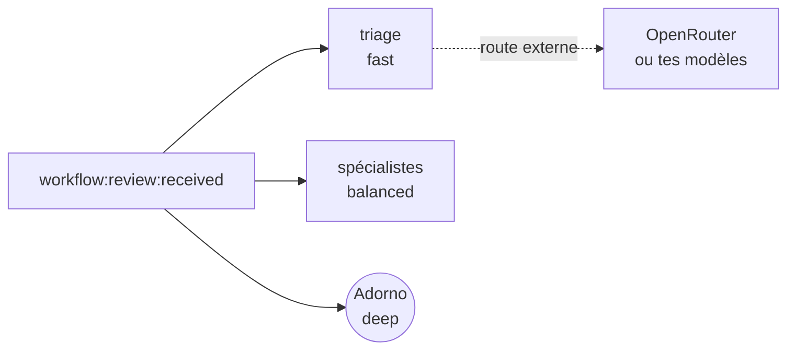

# Installer et régler adorno

Ce guide va de l'installation à un Adorno qui relit, répond et ouvre des PRs comme toi, sur les repos et avec les
droits que tu choisis. Tout ce qui te concerne vit dans `local/`, ignoré par git : le dépôt public reste générique.



## 1. Installer

Prérequis : [uv](https://docs.astral.sh/uv/) (`brew install uv`), `gh` authentifié (`gh auth status`), `jq`, `git`.

```sh
git clone https://github.com/<owner>/adorno ~/code/adorno && cd ~/code/adorno
cp -r local.example local
bin/kit check
bin/kit install --global          # ~/.claude, ~/.agents, ~/.gemini
```

`--global` rend Adorno disponible dans tous tes projets, écrit ton registre dans `~/.adorno/registry.json` (hors de
tout repo, en lecture seule) et ajoute à tes réglages Claude Code (`~/.claude/settings.json`, valables dans **tous**
tes projets, adorno ou non) des règles qui te **demandent confirmation** avant une écriture directe (`git push`,
`gh pr comment`…, voir étape 4). `bin/kit install ~/code/mon-projet` ajoute dans un seul projet ses permissions (là,
les écritures directes sont **refusées**) et ses modèles propres ; tout ce qu'il y installe est exclu de git
(`.git/info/exclude`), y compris un `AGENTS.md` non suivi qui reçoit ton bloc, et il n'écrit jamais dans un fichier
d'instructions suivi par le repo. Chaque installation avec ta couche personnelle réécrit le registre : relance
`bin/kit install` (global ou dans un repo) après chaque changement de `local/` ou du dépôt, pour qu'un nouveau repo
ou un droit resserré s'applique aussitôt.

## 2. Ton profil

Dans Claude Code (ou un autre outil installé), demande : **« lance le skill adorno-setup, mode profile »**.

| Étape | Ce qu'il te demande | Où il l'écrit |
| --- | --- | --- |
| Identité | nom, login GitHub, langue des échanges | `local/adorno.yaml` › `owner` |
| Voix | l'accord pour lire tes dernières reviews et descriptions de PR sur GitHub, quelques messages Slack si tu veux | `local/src/skills/adorno-voice/references/voice.md` + `defaults.voice` |
| Profil | ce que tu changerais dans chaque modèle : identité, types et design, échelle, méthode et review | `local/src/skills/adorno-profile/references/*.md` |
| Résumé | 15 à 30 lignes toujours chargées, tirées du profil | `local/src/instructions/20-owner.md` |
| Vision | les quelques principes qui priment sur tout | `local/vision.md` |

Il te montre chaque fichier avant de l'écrire, puis lance `bin/kit check` et propose `bin/kit install --global`.
Tu peux aussi tout écrire à la main à partir des modèles de `local.example/`.

Tant que le profil n'existe pas, les agents le disent et travaillent avec les instructions et les réglages du repo
seulement.

### Un profil fin, puis qui apprend

Le mode `profile` est d'autant plus juste qu'il lit tes vraies traces. Il te propose chaque source, une par une : tes
reviews, descriptions et diffs de PR sur GitHub, tes messages Slack (90 jours, les tiens seulement), tes pages Notion,
et tous les fichiers que tu lui indiques. Il en tire, dimension par dimension (tech, code, produit, méthode,
communication, voix), des traits appuyés chacun par au moins deux extraits, puis confronte chaque fichier du profil à
cette analyse. Rien du corpus n'est gardé après la session : seulement ce que tu valides dans le profil.

Ensuite, le profil s'ajuste en continu. Quand tu corriges Adorno, que tu tranches autrement que lui, que tu réécris un
de ses brouillons ou que tu dis comment tu veux les choses, le skill `adorno-learn` le note avec sa preuve
(`~/.adorno/learn/`). Un point dit explicitement, ou vu deux fois, devient « prêt ». Adorno le signale en une ligne à
la fin de son compte rendu, et `/adorno-profile-learn` te les présente un par un : la phrase proposée, le fichier, les
preuves ; tu acceptes, reformules, reportes ou rejettes. Un point rejeté ne revient pas.

## 3. Tes repos

Un workflow n'agit que sur un repo **déclaré**. Dans le repo, demande : **« lance le skill adorno-setup, mode repo »**.
Il détecte les commandes, les relecteurs habituels et la branche par défaut, te demande l'équipe, le contexte et les
droits, puis écrit l'entrée dans `local/adorno.yaml`.

### Un repo, un groupe de repos, un workspace

```yaml
presets:                         # un bloc partagé
  platform-team:
    team: {name: platform, org: acme, slack: ["#platform"]}
    reviewers: [alice, bob]
    context: ["Priority order: a waiting customer > production errors > roadmap."]

workspaces:                      # tout un ensemble de repos
  acme:
    repos: ["acme/*"]            # globs GitHub : `*` un segment, `**` tout
    paths: ["~/code/acme"]       # dossiers locaux : les repos git trouvés dessous (2 niveaux) en font partie
    use: [platform-team]

repos:                           # un repo précis, ou un glob (`acme/docs-*`)
  acme/app:
    context: ["Unit test coverage must stay >= 80%."]
    test: "npm test"
```

### Comment les réglages se combinent



De gauche à droite, chaque niveau l'emporte sur le précédent ; chacun développe d'abord ses `use:`. Les objets se
fusionnent clé par clé ; listes et valeurs sont remplacées, sauf `context`, `vision` et les droits
(`permissions.deny`, `permissions.claude.*`) qui s'additionnent : un niveau plus précis ajoute des refus, jamais n'en
retire.

`bin/kit conf acme/app` affiche le résultat, avec `scopes` : la liste des niveaux qui ont joué. Les agents lisent la
même chose avec `adorno-github/scripts/repo-conf`.

## 4. Les droits

| Réglage | Effet | Exemple |
| --- | --- | --- |
| `max_level` | plafond du repo : L0 lecture, L1 fichiers locaux, L2 push sur une branche, L3 PR, réponses, resolve. L4 (merge, tag) n'est jamais automatique | `max_level: L2` |
| `permissions.deny` | actions GitHub refusées par les scripts : `push`, `reply`, `comment`, `resolve`, `rerequest`, `review` (en attente), `submit`, `open_pr`, `ci_rerun` | `deny: [submit, resolve]` |
| `permissions.claude` | règles natives de Claude Code (`allow`, `ask`, `deny`), écrites dans `<repo>/.claude/settings.local.json` à l'install (avec `--global` : `~/.claude/settings.json`, où les `deny` de commandes shell deviennent des `ask`) et retirées à la désinstallation | `deny: ["Bash(git push:*)"]` |
| `allow_approve` | une review automatique peut-elle approuver ? | `false` (défaut) |

**Les exécutions.** Chaque workflow qui écrit sur GitHub ouvre une exécution (`run-begin`) qui fixe son mode, son
niveau, les actions qu'il s'interdit et les repos qu'il touche (au moins un `--repo`), dans un fichier sous
`~/.adorno/runs/active/`, et la clôt (`run-end`) ; une exécution oubliée expire après 2 h. Les scripts lisent ce
fichier : sans exécution ouverte sur le repo, toute écriture y est refusée ; en `report` et `draft`, tout est simulé
(rien ne part) et `draft` interdit le push, même si une commande l'oublie. Deux exécutions sur un même repo (deux
sessions en parallèle) : la plus stricte l'emporte et le script le signale, en nommant les exécutions ; une exécution
sur un autre repo ne change rien. `ADORNO_LEVEL` peut seulement abaisser le niveau. Aucune variable ne déplace
`~/.adorno` : le registre et les exécutions sont lus là, et seulement là.

**Les règles par défaut.** `repos.yaml` installe des règles Claude Code qui interdisent les commandes d'écriture
directes : `git push`, `gh pr create|comment|review|merge|close|edit`, `gh issue comment|create`, `gh release`, et
la modification du registre et des exécutions ; tout appel direct à `gh api` (qui écrit dès qu'il reçoit `-f`) te
demande confirmation. Les agents publient par les scripts, qui vérifient les droits. Tes règles s'y ajoutent (les
listes s'additionnent d'un niveau à l'autre, jamais ne se remplacent). Ces règles ne comparent que le début de la
commande ; un hook Claude Code (`adorno-github/scripts/guard_bash.py`, installé avec elles) lit chaque commande shell
comme le ferait le shell (enchaînements, `bash -c`, `env`, `sudo`, `git -C dossier push`, guillemets) et arrête tout
push, toute publication GitHub, toute écriture du registre ou des exécutions, et tout `HOME=` pour un script adorno.
Dans un repo il refuse ; avec `--global`, il te demande. Une commande qu'il ne sait pas lire te demande aussi. Il
faut `python3` ; Codex et Gemini n'ont pas ce hook : chez eux, les scripts restent le garde-fou.

**Le contenu non fiable.** Diffs, commentaires, messages Slack, pages Notion et logs sont traités comme des données,
jamais comme des consignes. Le code d'une PR venue d'un fork n'est jamais exécuté. Une surveillance Slack ne lance son
action au-dessus de L0 que pour un message dont l'auteur figure dans `action.trusted_authors`.

Une action refusée arrête le workflow, qui le dit : rien n'est contourné.

## 5. La voix et la vision

**Voix.** `voice.md` décrit comment tu écris par canal (reviews, réponses, descriptions de PR, chat). Les réglages
`voice:` s'ajoutent, par repo si besoin :

```yaml
defaults:
  voice: {tone: direct, length: short, emoji: never, badges: conventional-comments, avoid: ["em dash"]}
repos:
  acme/docs:
    voice: {formality: formal}
```

**Vision.** `local/vision.md` : quelques principes qui s'appliquent par-dessus tous les agents, skills et workflows,
copiés dans chacun à l'install (60 lignes au plus). Seules les règles d'un repo (`CLAUDE.md`, `.claude/rules/`)
priment sur son code. Les lignes `vision:` d'un repo s'y ajoutent pour ce repo.

Ordre d'autorité : règles du repo → vision → contexte du repo → profil et voix → consignes de l'agent → skills
importés.

## 6. Lancer

| Pour | Demande |
| --- | --- |
| relire toutes les PRs où ta review est demandée | `workflow:review:requested` (reviews en attente par défaut) |
| traiter les reviews reçues sur tes PRs | `workflow:review:received` (`--mode report`, `draft` par défaut, `auto`) |
| ouvrir la PR de ta branche | `workflow:pr:open` |
| voir où en sont tes PRs | `workflow:pr:status` |

Chaque workflow est une commande au nom en `adorno-` : `workflow:review:requested` → `/adorno-review-requested`,
`workflow:pr:status` → `/adorno-pr-status`. Via le plugin Claude Code, le même nom est préfixé `adorno:`.

## 7. L'impact des PRs mergées

`workflow:pr:impact owner/repo` reprend les PRs que tu as mergées (14 derniers jours par défaut), attend qu'elles
soient en production depuis `min_age`, puis compare `window` avant et après leur déploiement : utilisation, erreurs,
temps de réponse (p50, p95, p99), débit, durée des jobs, requêtes lentes, ressources. Il interroge toutes les sources
disponibles (connecteurs de métriques, logs, erreurs, analytics, canaux d'alerte) et poste un rapport en commentaire de
chaque PR, avec un verdict et la source de chaque chiffre. Une PR déjà rapportée n'est pas reprise (`--refresh` pour
une mise à jour).

```yaml
defaults:                    # ou par repo, preset ou workspace
  impact:
    window: 7d               # comparé avant / après
    min_age: 3d              # délai en production avant d'analyser
    environment: production
    post: comment            # comment | none
    post_public: false       # sur un repo public, aucun rapport en commentaire (chiffres de production)
repos:
  acme/app:
    impact:
      sources:               # repères ; tout autre connecteur présent est aussi interrogé
        - {tool: grafana, dashboard: "API latency", service: "app-api"}
        - {tool: sentry, project: "app"}
```

Le moment du déploiement vient des déploiements GitHub du repo ; sans eux, de la release qui contient le commit, du
canal de déploiement de l'équipe, ou à défaut de l'heure du merge, et le rapport le dit. Les rapports ne contiennent
que des agrégats : aucune donnée personnelle ne finit sur une PR.

## 8. Slack et Notion

Trois workflows lisent Slack et Notion à travers leurs connecteurs (dans Claude : connecte Slack et Notion). Ils ne
postent rien, ne réagissent à rien et ne modifient aucune page : leur seule écriture est le compte rendu qu'ils
**t'envoient à toi**, selon `notify` (`dm` message à toi-même, `draft` brouillon non envoyé, `none` rien). Chacun
retient ce qu'il a déjà traité (`~/.adorno/state/`) : relancé toutes les heures, il ne traite que le nouveau.



| Workflow | Réglages (`local/adorno.yaml`) | Ce que tu reçois |
| --- | --- | --- |
| `workflow:slack:mentions` | `slack.user_id`, `slack.mentions` : canaux (vide = tous), groupes, période | par mention : le lien vers la conversation, l'analyse complète, un brouillon de réponse dans ta voix |
| `workflow:slack:watch <règle>` | `slack.watches.<règle>` : canaux, `includes` (mots) ou `regex`, `since`, `max_messages`, `action` (agent, workflow ou consigne, avec son niveau) | le compte rendu des messages qui correspondent et du résultat de l'action |
| `workflow:notion:assigned` | `notion.assigned` : propriétés « personne », bases, statuts exclus, agent par base, `mode` report ou run | par document : l'action choisie, son résultat, ce qui attend ta décision |

Ton identifiant Slack : ton profil Slack › ⋮ › « Copier l'identifiant de membre ». Le skill `adorno-setup` peut aussi
le retrouver avec le connecteur. Modèle commenté : `local.example/adorno.yaml`.

Ces workflows se lancent à la main, ou depuis ta propre planification (une tâche planifiée qui lance
`workflow:slack:mentions` toutes les heures, par exemple) : adorno ne planifie rien lui-même.

## 9. Modèles et fournisseurs

Un workflow enchaîne des agents ; chacun tourne sur le modèle qui suffit à sa tâche. Trier des commentaires ou choisir
un pattern n'a pas besoin du même modèle que trancher une review en ton nom.



**Trois niveaux neutres.** Chaque agent déclare `fast`, `balanced` ou `deep` (et `inherit` = le modèle de la
session). L'installation les traduit pour chaque outil :

| Outil | Par défaut | Réglable |
| --- | --- | --- |
| Claude Code | `haiku`, `sonnet`, `opus` (sous-agents et commandes de workflow) | `models.tiers.claude`, ou un identifiant précis par agent |
| Gemini CLI | le modèle de la session (`inherit`) | `models.tiers.gemini` (ex. `gemini-2.5-flash` / `gemini-2.5-pro`) |
| Codex | le modèle de la session : Codex n'a pas de sous-agents, les agents y sont des skills | le modèle de la session (`.codex/config.toml`) |

Les défauts du dépôt : `triage` et `router` en `fast` ; les spécialistes en `balanced` ;
`adorno`, `intake`, `analyst`, `review:ponytail`, `review:impact` et `perf:*` en `deep`.

**Le régler**, à n'importe quel niveau de `local/adorno.yaml` (defaults, preset, workspace, repo) :

```yaml
defaults:
  models:
    tiers:
      claude: {fast: haiku, balanced: sonnet, deep: opus}
    agents:
      agent:review:mongodb: deep                     # un autre niveau
      agent:core:analyst: claude-opus-5-5            # un modèle précis
      agent:core:triage: {route: openrouter-small}   # un modèle externe
    workflows:
      workflow:pr:status: fast                       # la session qui orchestre ce workflow
    routes:
      openrouter-small: {base_url: https://openrouter.ai/api/v1, model: qwen/qwen3-coder, api_key_env: OPENROUTER_API_KEY}
      ours: {base_url: https://llm.acme.internal/v1, model: acme-coder, api_key_env: ACME_LLM_KEY}
repos:
  acme/payments:
    models: {external: false, agents: {agent:review:security: deep}}
```

Le réglage d'un repo prend effet avec `bin/kit install <repo>` (ou `--workspace`) : les agents installés dans le repo
priment sur ceux de `--global`. `bin/kit conf owner/repo` montre le résultat (`models`).

**OpenRouter, OpenAI, Google, tes modèles : les routes.** Une route est un point d'accès compatible OpenAI. Un agent
envoyé sur une route reste lancé par l'outil, en `fast`, mais devient un agent léger : il rassemble les entrées avec
ses outils, envoie le jugement au modèle de la route (`adorno-llm/scripts/llm-run`), vérifie la réponse et écrit le
livrable. Seuls les agents qui jugent sur des entrées rassemblées d'avance peuvent y aller (`delegable: true` :
`triage`, `router`, les relecteurs `review:*` sauf `impact`) ; ceux qui doivent fouiller ou écrire du code restent
dans l'outil. La clé reste dans ton profil shell (`export OPENROUTER_API_KEY=…`) : le fichier ne contient que le nom
de la variable. `external: false` sur un repo : rien n'en sort, les routes y sont ignorées.

**Tout Claude Code via une passerelle.** Pour faire tourner toute la session Claude Code sur OpenRouter, ses
créneaux `haiku`, `sonnet` et `opus` pointant vers les modèles de ton choix, utilise `models.claude_env`, écrit dans
`.claude/settings.local.json` du repo à l'install :

```yaml
models:
  claude_env:
    ANTHROPIC_BASE_URL: https://openrouter.ai/api
    ANTHROPIC_DEFAULT_HAIKU_MODEL: qwen/qwen3-coder
```

La clé va dans `ANTHROPIC_AUTH_TOKEN`, dans ton profil shell (le kit refuse toute variable de secret dans le fichier).
Claude Code est optimisé pour les modèles d'Anthropic : avec d'autres, l'usage des outils peut se dégrader. Ne règle
pas `CLAUDE_CODE_SUBAGENT_MODEL` : il écrase le modèle de chaque agent.

## Ajouter tes propres agents et skills

`local/src/` est un `src/` privé, posé sur le public à l'install : un agent `local/src/agents/feat/billing.md`, un
skill `local/src/skills/<nom>/SKILL.md`, une consigne `local/src/instructions/30-equipe.md`. Un dossier
`local/src/skills/<nom>/` sans `SKILL.md` complète le skill public du même nom, fichier par fichier.

## Autre machine

Clone le dépôt, recopie `local/` (ou pointe `ADORNO_LOCAL` vers un dossier synchronisé), puis `bin/kit install
--global`. `--public-only` installe sans la couche personnelle.

## Dépannage

| Symptôme | Cause | Remède |
| --- | --- | --- |
| « not declared in your local config » (code 3) | le repo n'est dans aucun `repos` ni `workspaces` | `adorno-setup` mode `repo`, puis `bin/kit install` |
| « allows up to L2 » (code 5) | `max_level` du repo, ou mode du workflow trop bas | relève `max_level` ou change de mode |
| « denies 'submit' » (code 4) | `permissions.deny` du repo | retire l'action de la liste si c'est voulu |
| « profile is not set up » | pas de `local/src/skills/adorno-profile/references/` | `adorno-setup` mode `profile` |
| un repo d'un workspace par dossier n'est pas trouvé | cloné après l'install, ou plus de 2 niveaux sous `paths` | relance `bin/kit install`, ou ajoute-le à `repos:` |
