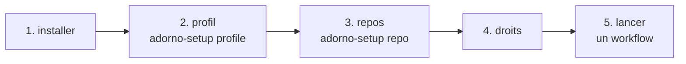
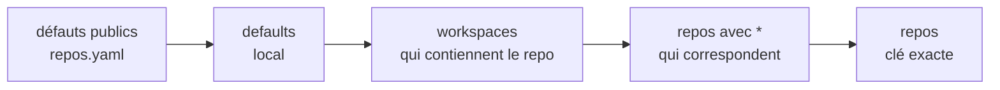
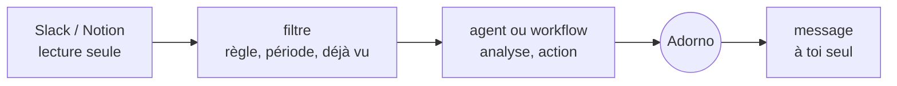

# Installer et régler adorno

Ce guide va de l'installation à un Adorno qui relit, répond et ouvre des PRs comme toi, sur les repos et avec les
droits que tu choisis. Tout ce qui te concerne vit dans `local/`, ignoré par git : le dépôt public reste générique.



## 1. Installer

Prérequis : [uv](https://docs.astral.sh/uv/) (`brew install uv`), `gh` authentifié (`gh auth status`), `jq`, `git`.

```sh
git clone https://github.com/<owner>/adorno ~/code/adorno && cd ~/code/adorno
cp -r local.example local
bin/kit check
bin/kit install --global          # ~/.claude, ~/.agents, ~/.gemini
```

`--global` rend Adorno disponible dans tous tes projets. `bin/kit install ~/code/mon-projet` l'installe dans un seul
projet, et y écrit en plus les permissions natives de ce repo (étape 4). Relance `bin/kit install` après chaque
changement de `local/` ou du dépôt.

## 2. Ton profil

Dans Claude Code (ou un autre outil installé), demande : **« lance le skill adorno-setup, mode profile »**.

| Étape | Ce qu'il te demande | Où il l'écrit |
| --- | --- | --- |
| Identité | nom, login GitHub, langue des échanges | `local/adorno.yaml` › `owner` |
| Voix | l'accord pour lire tes dernières reviews et descriptions de PR sur GitHub, quelques messages Slack si tu veux | `local/src/skills/adorno-voice/references/voice.md` + `defaults.voice` |
| Profil | ce que tu changerais dans chaque modèle : identité, types et design, échelle, méthode et review | `local/src/skills/adorno-profile/references/*.md` |
| Résumé | 15 à 30 lignes toujours chargées, tirées du profil | `local/src/instructions/20-owner.md` |
| Vision | les quelques principes qui priment sur tout | `local/vision.md` |

Il te montre chaque fichier avant de l'écrire, puis lance `bin/kit check` et propose `bin/kit install --global`.
Tu peux aussi tout écrire à la main à partir des modèles de `local.example/`.

Tant que le profil n'existe pas, les agents le disent et travaillent avec les instructions et les réglages du repo
seulement.

## 3. Tes repos

Un workflow n'agit que sur un repo **déclaré**. Dans le repo, demande : **« lance le skill adorno-setup, mode repo »**.
Il détecte les commandes, les relecteurs habituels et la branche par défaut, te demande l'équipe, le contexte et les
droits, puis écrit l'entrée dans `local/adorno.yaml`.

### Un repo, un groupe de repos, un workspace

```yaml
presets:                         # un bloc partagé
  platform-team:
    team: {name: platform, org: acme, slack: ["#platform"]}
    reviewers: [alice, bob]
    context: ["Priority order: a waiting customer > production errors > roadmap."]

workspaces:                      # tout un ensemble de repos
  acme:
    repos: ["acme/*"]            # globs GitHub : `*` un segment, `**` tout
    paths: ["~/code/acme"]       # dossiers locaux : les repos git trouvés dessous (2 niveaux) en font partie
    use: [platform-team]

repos:                           # un repo précis, ou un glob (`acme/docs-*`)
  acme/app:
    context: ["Unit test coverage must stay >= 80%."]
    test: "npm test"
```

### Comment les réglages se combinent



De gauche à droite, chaque niveau l'emporte sur le précédent ; chacun développe d'abord ses `use:`. Les objets se
fusionnent clé par clé ; listes et valeurs sont remplacées, sauf `context` et `vision` qui s'additionnent.

`bin/kit conf acme/app` affiche le résultat, avec `scopes` : la liste des niveaux qui ont joué. Les agents lisent la
même chose avec `github-ops/scripts/repo-conf`.

## 4. Les droits

| Réglage | Effet | Exemple |
| --- | --- | --- |
| `max_level` | plafond du repo : L0 lecture, L1 fichiers locaux, L2 push sur une branche, L3 PR, réponses, resolve. L4 (merge, tag) n'est jamais automatique | `max_level: L2` |
| `permissions.deny` | actions GitHub refusées par les scripts : `push`, `reply`, `comment`, `resolve`, `rerequest`, `review` (en attente), `submit`, `open_pr`, `ci_rerun` | `deny: [submit, resolve]` |
| `permissions.claude` | règles natives de Claude Code (`allow`, `ask`, `deny`), écrites dans `<repo>/.claude/settings.local.json` à l'install et retirées à la désinstallation | `deny: ["Bash(git push:*)"]` |
| `allow_approve` | une review automatique peut-elle approuver ? | `false` (défaut) |

Le niveau d'une exécution est aussi fixé par le mode du workflow (`report` L0, `draft` L2, `auto` L3) ; le plus bas des
deux l'emporte. Une action refusée arrête le workflow, qui le dit : rien n'est contourné.

## 5. La voix et la vision

**Voix.** `voice.md` décrit comment tu écris par canal (reviews, réponses, descriptions de PR, chat). Les réglages
`voice:` s'ajoutent, par repo si besoin :

```yaml
defaults:
  voice: {tone: direct, length: short, emoji: never, badges: conventional-comments, avoid: ["em dash"]}
repos:
  acme/docs:
    voice: {formality: formal}
```

**Vision.** `local/vision.md` : quelques principes qui s'appliquent par-dessus tous les agents, skills et workflows,
copiés dans chacun à l'install (60 lignes au plus). Seules les règles d'un repo (`CLAUDE.md`, `.claude/rules/`)
priment sur son code. Les lignes `vision:` d'un repo s'y ajoutent pour ce repo.

Ordre d'autorité : règles du repo → vision → contexte du repo → profil et voix → consignes de l'agent → skills
importés.

## 6. Lancer

| Pour | Demande |
| --- | --- |
| relire toutes les PRs où ta review est demandée | `workflow:review:requested` (reviews en attente par défaut) |
| traiter les reviews reçues sur tes PRs | `workflow:review:received` (`--mode report`, `draft` par défaut, `auto`) |
| ouvrir la PR de ta branche | `workflow:pr:open` |
| voir où en sont tes PRs | `workflow:pr:status` |

Dans Claude Code via le plugin, les commandes s'appellent `/adorno:workflow-review-requested`, etc.

## 7. Slack et Notion

Trois workflows lisent Slack et Notion à travers leurs connecteurs (dans Claude : connecte Slack et Notion). Ils ne
postent rien, ne réagissent à rien et ne modifient aucune page : leur seule écriture est le compte rendu qu'ils
**t'envoient à toi**, selon `notify` (`dm` message à toi-même, `draft` brouillon non envoyé, `none` rien). Chacun
retient ce qu'il a déjà traité (`~/.adorno/state/`) : relancé toutes les heures, il ne traite que le nouveau.



| Workflow | Réglages (`local/adorno.yaml`) | Ce que tu reçois |
| --- | --- | --- |
| `workflow:slack:mentions` | `slack.user_id`, `slack.mentions` : canaux (vide = tous), groupes, période | par mention : le lien vers la conversation, l'analyse complète, un brouillon de réponse dans ta voix |
| `workflow:slack:watch <règle>` | `slack.watches.<règle>` : canaux, `includes` (mots) ou `regex`, `since`, `max_messages`, `action` (agent, workflow ou consigne, avec son niveau) | le compte rendu des messages qui correspondent et du résultat de l'action |
| `workflow:notion:assigned` | `notion.assigned` : propriétés « personne », bases, statuts exclus, agent par base, `mode` report ou run | par document : l'action choisie, son résultat, ce qui attend ta décision |

Ton identifiant Slack : ton profil Slack › ⋮ › « Copier l'identifiant de membre ». Le skill `adorno-setup` peut aussi
le retrouver avec le connecteur. Modèle commenté : `local.example/adorno.yaml`.

Ces workflows se lancent à la main, ou depuis ta propre planification (une tâche planifiée qui lance
`workflow:slack:mentions` toutes les heures, par exemple) : adorno ne planifie rien lui-même.

## Ajouter tes propres agents et skills

`local/src/` est un `src/` privé, posé sur le public à l'install : un agent `local/src/agents/feat/billing.md`, un
skill `local/src/skills/<nom>/SKILL.md`, une consigne `local/src/instructions/30-equipe.md`. Un dossier
`local/src/skills/<nom>/` sans `SKILL.md` complète le skill public du même nom, fichier par fichier.

## Autre machine

Clone le dépôt, recopie `local/` (ou pointe `ADORNO_LOCAL` vers un dossier synchronisé), puis `bin/kit install
--global`. `--public-only` installe sans la couche personnelle.

## Dépannage

| Symptôme | Cause | Remède |
| --- | --- | --- |
| « not declared in your local config » (code 3) | le repo n'est dans aucun `repos` ni `workspaces` | `adorno-setup` mode `repo`, puis `bin/kit install` |
| « allows up to L2 » (code 5) | `max_level` du repo, ou mode du workflow trop bas | relève `max_level` ou change de mode |
| « denies 'submit' » (code 4) | `permissions.deny` du repo | retire l'action de la liste si c'est voulu |
| « profile is not set up » | pas de `local/src/skills/adorno-profile/references/` | `adorno-setup` mode `profile` |
| un repo d'un workspace par dossier n'est pas trouvé | cloné après l'install, ou plus de 2 niveaux sous `paths` | relance `bin/kit install`, ou ajoute-le à `repos:` |
