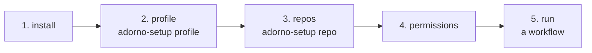
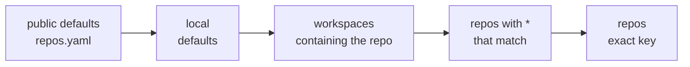
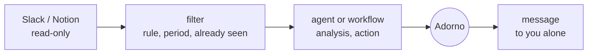

# Install and configure adorno

This guide goes from installation to an Adorno that reviews, replies and opens PRs like you, on the repos and with
the permissions you choose. Everything about you lives in `local/`, ignored by git: the public repo stays generic.



## 1. Install

Prerequisites: [uv](https://docs.astral.sh/uv/) (`brew install uv`), authenticated `gh` (`gh auth status`), `jq`, `git`.

```sh
git clone https://github.com/<owner>/adorno ~/code/adorno && cd ~/code/adorno
cp -r local.example local
bin/kit check
bin/kit install --global          # ~/.claude, ~/.agents, ~/.gemini
```

`--global` makes Adorno available in all your projects, writes your registry to `~/.adorno/registry.json` (outside any
repo, read-only) and adds to your Claude Code settings (`~/.claude/settings.json`, valid in **all** your projects,
adorno or not) rules that **ask you for confirmation** before a direct write (`git push`,
`gh pr comment`…, see step 4). `bin/kit install ~/code/my-project` adds its permissions to a single project (there,
direct writes are **refused**) and its own models; everything it installs there is excluded from git
(`.git/info/exclude`), including an untracked `AGENTS.md` that receives your block, and it never writes into an
instructions file tracked by the repo. Each install with your personal layer rewrites the registry: rerun
`bin/kit install` (global or in a repo) after each change to `local/` or to the repo, so that a new repo
or a tightened permission applies right away.

## 2. Your profile

In Claude Code (or another installed tool), ask: **"run the adorno-setup skill, profile mode"**.

| Step | What it asks you | Where it writes it |
| --- | --- | --- |
| Identity | name, GitHub login, language of the exchanges | `local/adorno.yaml` › `owner` |
| Voice | your agreement to read your latest reviews and PR descriptions on GitHub, a few Slack messages if you want | `local/src/skills/adorno-voice/references/voice.md` + `defaults.voice` |
| Profile | what you would change in each model: identity, types and design, scale, method and review | `local/src/skills/adorno-profile/references/*.md` |
| Summary | 15 to 30 lines always loaded, drawn from the profile | `local/src/instructions/20-owner.md` |
| Vision | the few principles that override everything | `local/vision.md` |

It shows you each file before writing it, then runs `bin/kit check` and offers `bin/kit install --global`.
You can also write everything by hand from the templates in `local.example/`.

As long as the profile does not exist, the agents say so and work with the repo's instructions and settings
only.

### A fine profile, then one that learns

The `profile` mode is all the more accurate as it reads your real traces. It offers you each source, one by one: your
reviews, PR descriptions and diffs on GitHub, your Slack messages (90 days, yours only), your Notion pages,
and any files you point it to. From them it draws, dimension by dimension (tech, code, product, method,
communication, voice), traits each backed by at least two excerpts, then checks each profile file against
that analysis. Nothing from the corpus is kept after the session: only what you validate in the profile.

After that, the profile adjusts continuously. When you correct Adorno, decide differently from it, rewrite one of
its drafts or say how you want things done, the `adorno-learn` skill notes it with its evidence
(`~/.adorno/learn/`). A point said explicitly, or seen twice, becomes "ready". Adorno flags it in one line at
the end of its report, and `/adorno-profile-learn` presents them to you one by one: the proposed sentence, the file, the
evidence; you accept, rephrase, postpone or reject. A rejected point does not come back.

## 3. Your repos

A workflow only acts on a **declared** repo. In the repo, ask: **"run the adorno-setup skill, repo mode"**.
It detects the commands, the usual reviewers and the default branch, asks you for the team, the context and the
permissions, then writes the entry in `local/adorno.yaml`.

### A repo, a group of repos, a workspace

```yaml
presets:                         # a shared block
  platform-team:
    team: {name: platform, org: acme, slack: ["#platform"]}
    reviewers: [alice, bob]
    context: ["Priority order: a waiting customer > production errors > roadmap."]

workspaces:                      # a whole set of repos
  acme:
    repos: ["acme/*"]            # GitHub globs: `*` one segment, `**` everything
    paths: ["~/code/acme"]       # local folders: the git repos found below (2 levels) are part of it
    use: [platform-team]

repos:                           # a specific repo, or a glob (`acme/docs-*`)
  acme/app:
    context: ["Unit test coverage must stay >= 80%."]
    test: "npm test"
```

### How the settings combine



From left to right, each level overrides the previous one; each one expands its `use:` first. Objects
merge key by key; lists and values are replaced, except `context`, `vision` and the permissions
(`permissions.deny`, `permissions.claude.*`) which add up: a more specific level adds denials, never removes any.

`bin/kit conf acme/app` shows the result, with `scopes`: the list of levels that played a part. The agents read the
same thing with `adorno-github/scripts/repo-conf`.

## 4. Permissions

| Setting | Effect | Example |
| --- | --- | --- |
| `max_level` | repo cap: L0 read, L1 local files, L2 push to a branch, L3 PR, replies, resolve. L4 (merge, tag) is never automatic | `max_level: L2` |
| `permissions.deny` | GitHub actions refused by the scripts: `push`, `reply`, `comment`, `resolve`, `rerequest`, `review` (pending), `submit`, `open_pr`, `ci_rerun` | `deny: [submit, resolve]` |
| `permissions.claude` | native Claude Code rules (`allow`, `ask`, `deny`), written into `<repo>/.claude/settings.local.json` at install (with `--global`: `~/.claude/settings.json`, where shell command `deny` rules become `ask`) and removed at uninstall | `deny: ["Bash(git push:*)"]` |
| `allow_approve` | can an automatic review approve? | `false` (default) |

**Runs.** Every workflow that writes to GitHub opens a run (`run-begin`) that fixes its mode, its
level, the actions it forbids itself and the repos it touches (at least one `--repo`), in a file under
`~/.adorno/runs/active/`, and closes it (`run-end`); a forgotten run expires after 2 h. The scripts read that
file: without a run open on the repo, any write there is refused; in `report` and `draft`, everything is simulated
(nothing goes out) and `draft` forbids push, even if a command forgets it. A run belongs to the Claude Code
session that opened it (`CLAUDE_CODE_SESSION_ID`, set by Claude Code in each command): another
session does not see it, and cannot lower or raise your permissions. Outside a session (Codex, Gemini, your terminal),
only runs opened outside a session count. After a `/clear`, the session changes: reopen the run.
Two runs of the same session on the same repo: the strictest wins, and the script says so.
`ADORNO_LEVEL` can only lower the level. No variable moves `~/.adorno`: the registry and the
runs are read there, and only there. The real cap remains the repo's `max_level`: the agent declares the
mode and level of its run, `max_level` and `permissions.deny` bound them.

**The default rules.** `repos.yaml` installs Claude Code rules that forbid direct write commands:
`git push`, `gh pr create|comment|review|merge|close|edit`, `gh issue comment|create`, `gh release`, and
modification of the registry and the runs; any direct call to `gh api` (which writes as soon as it gets `-f`) asks
you for confirmation. The agents publish through the scripts, which check the permissions. Your rules are added to them (lists
add up from one level to the next, never replace each other).

**The guard hook.** The rules only compare the start of a command. `bin/kit install` also installs a hook
(`adorno-github/scripts/guard_bash.py`) that reads each shell command the way the shell would: chains,
subshells, `$( … )` and backticks, `bash -c`, `eval`, `env`, `sudo`, `timeout`, `git -C folder`, git aliases,
the code passed to `python3 -c` or `node -e`, and the local scripts a command runs (`./deploy.sh`,
`bash x.sh`). It stops any push, any GitHub publication, any write to the registry or the runs, any
`HOME=` in front of an adorno script and any attempt to set `CLAUDE_CODE_SESSION_ID`. A command it cannot
read (a variable as program, unclosed quotes) asks you; so does a bug in the hook. Where nobody can answer
(`bypassPermissions` or `dontAsk`: a schedule, a headless run), every "asks" becomes a refusal carrying the reason,
so the agent rewrites its command instead of hanging. Without `python3`, or
if the hook file is missing, it blocks every shell command rather than let it through.

| Tool | In a repo | With `--global` |
| --- | --- | --- |
| Claude Code | hook, refuses (`.claude/settings.local.json`) | hook, asks; refuses in `bypassPermissions` / `dontAsk` (`~/.claude/settings.json`) |
| Codex | hook, refuses (`.codex/hooks.json`) | `prompt` rules (`~/.codex/rules/adorno.rules`): asks |
| Gemini CLI | `BeforeTool` hook, refuses (`.gemini/settings.json`) | `ask_user` policy (`~/.gemini/policies/adorno.toml`): asks |

The Codex and Gemini hooks can only refuse: in global mode, they leave room to the native confirmation rules,
which compare the start of the command. A hook file tracked by the repo is never modified
(warning); those adorno creates are excluded from git. What the hook does not see: a program that pushes without
its words appearing (a binary, a `make` whose recipe pushes, a script in another language launched by
another), a computed variable. It is a safeguard against mistakes and ordinary workarounds; the absolute barrier
is on the GitHub side.

**On the GitHub side.** `adorno-github/scripts/repo-audit [owner/repo…]` (read-only; without arguments, every repo in
your registry) tells what GitHub itself enforces: the type of token `gh` uses (a classic `repo` token
can do everything, everywhere) and whether each repo's default branch requires a pull request and blocks force
pushes (ruleset or branch protection). Recommended: a *fine-grained* token limited to the repos where adorno works
(Contents, Pull requests, Issues: read and write; Actions: read; no Administration), and a ruleset
on every default branch (Settings › Rules: pull request required, force push blocked). Even a write that
passed all of adorno's guards would then be refused by GitHub.

**Untrusted content.** Diffs, comments, Slack messages, Notion pages and logs are treated as data,
never as instructions. The code of a PR coming from a fork is never executed. A Slack watch only launches its
action above L0 for a message whose author is in `action.trusted_authors`.

A refused action stops the workflow, which says so: nothing is worked around.

## 5. Voice and vision

**Voice.** `voice.md` describes how you write per channel (reviews, replies, PR descriptions, chat). The `voice:`
settings are added to it, per repo if needed:

```yaml
defaults:
  voice: {tone: direct, length: short, emoji: never, badges: conventional-comments, avoid: ["em dash"]}
repos:
  acme/docs:
    voice: {formality: formal}
```

**Vision.** `local/vision.md`: a few principles that apply on top of all agents, skills and workflows,
copied into each at install (60 lines at most). Only a repo's rules (`CLAUDE.md`, `.claude/rules/`)
override them on its code. A repo's `vision:` lines are added to it for that repo.

Order of authority: repo rules → vision → repo context → profile and voice → agent instructions → imported
skills.

## 6. Run

| To | Ask |
| --- | --- |
| review all the PRs where your review is requested | `workflow:review:requested` (pending reviews by default) |
| handle the reviews received on your PRs | `workflow:review:received` (`--mode report`, `draft` by default, `auto`) |
| open your branch's PR | `workflow:pr:open` |
| see where your PRs stand | `workflow:pr:status` |

Each workflow is a command named with the `adorno-` prefix: `workflow:review:requested` → `/adorno-review-requested`,
`workflow:pr:status` → `/adorno-pr-status`. Through the Claude Code plugin, the same name is prefixed with `adorno:`.

## 7. The impact of merged PRs

`workflow:pr:impact owner/repo` takes the PRs you merged (last 14 days by default), waits until they have been in
production for `min_age`, then compares `window` before and after their deployment: usage, errors,
response times (p50, p95, p99), throughput, job duration, slow queries, resources. It queries all available
sources (metrics connectors, logs, errors, analytics, alert channels) and posts a report as a comment on
each PR, with a verdict and the source of each figure. A PR already reported is not taken again (`--refresh` for
an update).

```yaml
defaults:                    # or per repo, preset or workspace
  impact:
    window: 7d               # compared before / after
    min_age: 3d              # time in production before analyzing
    environment: production
    post: comment            # comment | none
    post_public: false       # on a public repo, no report as a comment (production figures)
repos:
  acme/app:
    impact:
      sources:               # hints; any other connector present is also queried
        - {tool: grafana, dashboard: "API latency", service: "app-api"}
        - {tool: sentry, project: "app"}
```

The deployment time comes from the repo's GitHub deployments; without them, from the release that contains the commit,
the team's deployment channel, or failing that the merge time, and the report says so. The reports contain
only aggregates: no personal data ends up on a PR.

## 8. Slack and Notion

Three workflows read Slack and Notion through their connectors (in Claude: connect Slack and Notion). They post
nothing, react to nothing and modify no page: their only write is the report they
**send to you**, according to `notify` (`dm` message to yourself, `draft` unsent draft, `none` nothing). Each one
remembers what it has already processed (`~/.adorno/state/`): rerun every hour, it only processes what is new.



| Workflow | Settings (`local/adorno.yaml`) | What you receive |
| --- | --- | --- |
| `workflow:slack:mentions` | `slack.user_id`, `slack.mentions`: channels (empty = all), groups, period | per mention: the link to the conversation, the full analysis, a draft reply in your voice |
| `workflow:slack:watch <rule>` | `slack.watches.<rule>`: channels, `includes` (words) or `regex`, `since`, `max_messages`, `action` (agent, workflow or instruction, with its level) | the report of the matching messages and of the action's result |
| `workflow:notion:assigned` | `notion.assigned`: "person" properties, databases, excluded statuses, agent per database, `mode` report or run | per document: the chosen action, its result, what awaits your decision |

Your Slack ID: your Slack profile › ⋮ › "Copy member ID". The `adorno-setup` skill can also
find it with the connector. Commented template: `local.example/adorno.yaml`.

These workflows are launched by hand, or from your own scheduler (a scheduled task that runs
`workflow:slack:mentions` every hour, for example): adorno schedules nothing itself.

## 9. Models and providers

A workflow chains agents; each one runs on the model that is enough for its task. Sorting comments or choosing
a pattern does not need the same model as deciding a review in your name.


**Three neutral tiers.** Each agent declares `fast`, `balanced` or `deep` (and `inherit` = the session's model). The
install translates them for each tool:

| Tool | Default | Configurable |
| --- | --- | --- |
| Claude Code | `haiku`, `sonnet`, `opus` (subagents and workflow commands) | `models.tiers.claude`, or a specific identifier per agent |
| Gemini CLI | the session's model (`inherit`) | `models.tiers.gemini` (e.g. `gemini-2.5-flash` / `gemini-2.5-pro`) |
| Codex | the session's model: Codex has no subagents, the agents are skills there | the session's model (`.codex/config.toml`) |

The repo's defaults: `triage` and `router` on `fast`; the specialists on `balanced`;
`adorno`, `intake`, `analyst`, `review:ponytail`, `review:impact` and `perf:*` on `deep`.

**Setting it**, at any level of `local/adorno.yaml` (defaults, preset, workspace, repo):

```yaml
defaults:
  models:
    tiers:
      claude: {fast: haiku, balanced: sonnet, deep: opus}
    agents:
      agent:review:mongodb: deep                     # another tier
      agent:core:analyst: claude-opus-5-5            # a specific model
      agent:core:triage: {route: openrouter-small}   # an external model
    workflows:
      workflow:pr:status: fast                       # the session that orchestrates this workflow
    routes:
      openrouter-small: {base_url: https://openrouter.ai/api/v1, model: qwen/qwen3-coder, api_key_env: OPENROUTER_API_KEY}
      ours: {base_url: https://llm.acme.internal/v1, model: acme-coder, api_key_env: ACME_LLM_KEY}
repos:
  acme/payments:
    models: {external: false, agents: {agent:review:security: deep}}
```

A repo's setting takes effect with `bin/kit install <repo>` (or `--workspace`): the agents installed in the repo
override those of `--global`. `bin/kit conf owner/repo` shows the result (`models`).

**OpenRouter, OpenAI, Google, your models: routes.** A route is an OpenAI-compatible endpoint. An agent
sent to a route is still launched by the tool, on `fast`, but becomes a light agent: it gathers the inputs with
its tools, sends the judgment to the route's model (`adorno-llm/scripts/llm-run`), checks the response and writes the
deliverable. Only agents that judge on inputs gathered in advance can go there (`delegable: true`:
`triage`, `router`, the `review:*` reviewers except `impact`); those that must dig or write code stay
in the tool. The key stays in your shell profile (`export OPENROUTER_API_KEY=…`): the file only contains the name
of the variable. `external: false` on a repo: nothing leaves it, routes are ignored there.

**All of Claude Code through a gateway.** To run the whole Claude Code session on OpenRouter, its
`haiku`, `sonnet` and `opus` slots pointing to the models of your choice, use `models.claude_env`, written into
the repo's `.claude/settings.local.json` at install:

```yaml
models:
  claude_env:
    ANTHROPIC_BASE_URL: https://openrouter.ai/api
    ANTHROPIC_DEFAULT_HAIKU_MODEL: qwen/qwen3-coder
```

The key goes in `ANTHROPIC_AUTH_TOKEN`, in your shell profile (the kit refuses any secret variable in the file).
Claude Code is optimized for Anthropic's models: with others, tool use may degrade. Do not set
`CLAUDE_CODE_SUBAGENT_MODEL`: it overrides each agent's model.

## Adding your own agents and skills

`local/src/` is a private `src/`, laid over the public one at install: an agent `local/src/agents/feat/billing.md`, a
skill `local/src/skills/<name>/SKILL.md`, an instruction `local/src/instructions/30-team.md`. A folder
`local/src/skills/<name>/` without `SKILL.md` completes the public skill of the same name, file by file.

## Another machine

Clone the repo, copy `local/` over (or point `ADORNO_LOCAL` to a synced folder), then `bin/kit install
--global`. `--public-only` installs without the personal layer.

## Troubleshooting

| Symptom | Cause | Remedy |
| --- | --- | --- |
| "not declared in your local config" (code 3) | the repo is in no `repos` or `workspaces` | `adorno-setup` repo mode, then `bin/kit install` |
| "allows up to L2" (code 5) | the repo's `max_level`, or the workflow's mode is too low | raise `max_level` or change mode |
| "denies 'submit'" (code 4) | the repo's `permissions.deny` | remove the action from the list if intended |
| "profile is not set up" | no `local/src/skills/adorno-profile/references/` | `adorno-setup` profile mode |
| a repo of a folder-based workspace is not found | cloned after the install, or more than 2 levels below `paths` | rerun `bin/kit install`, or add it to `repos:` |
