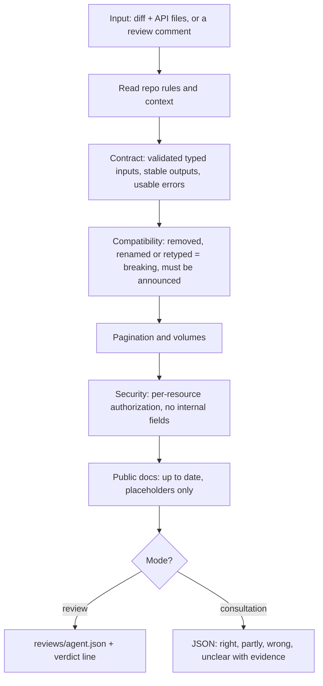
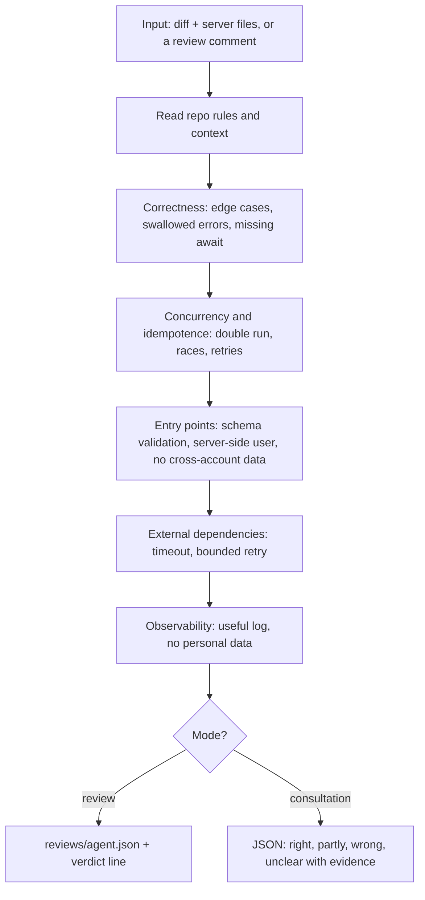
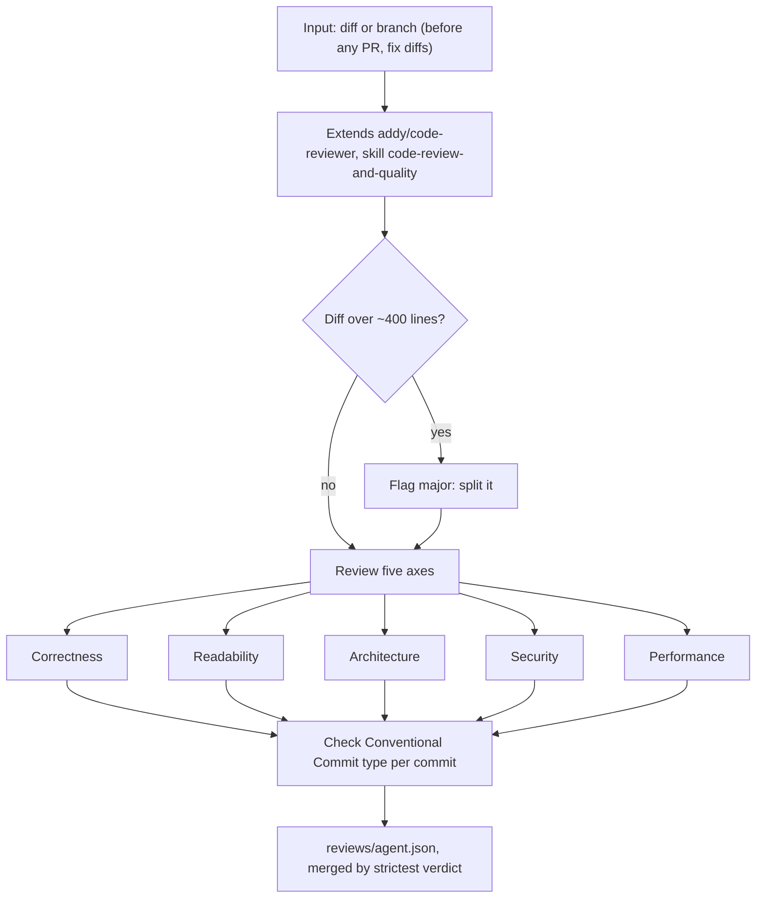
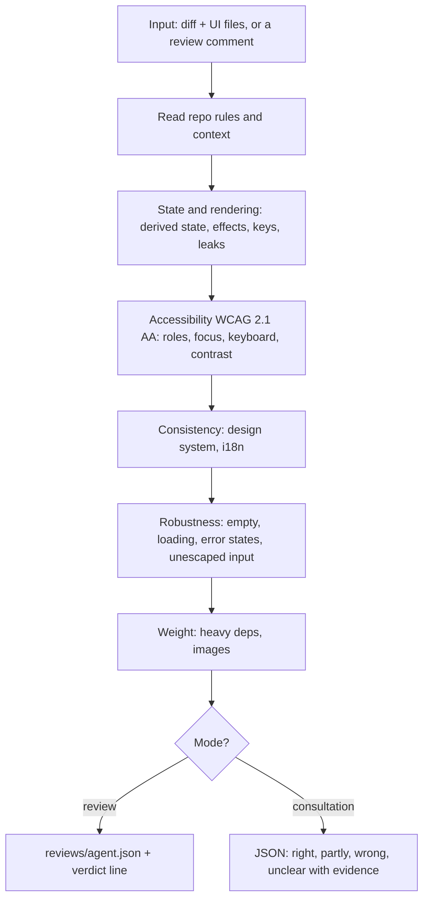
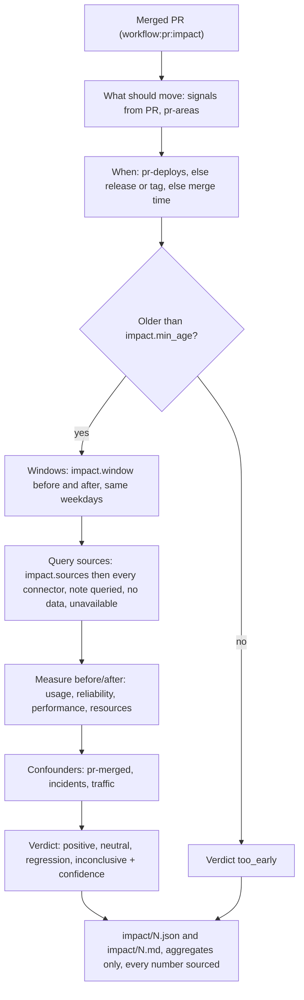
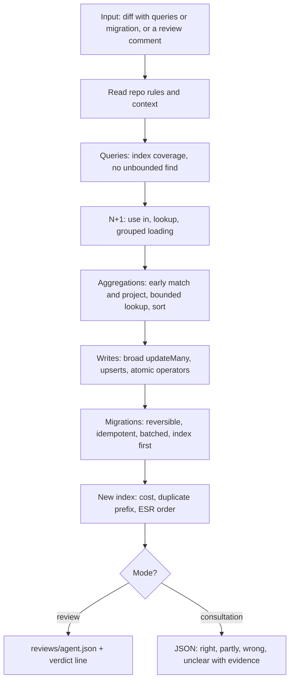
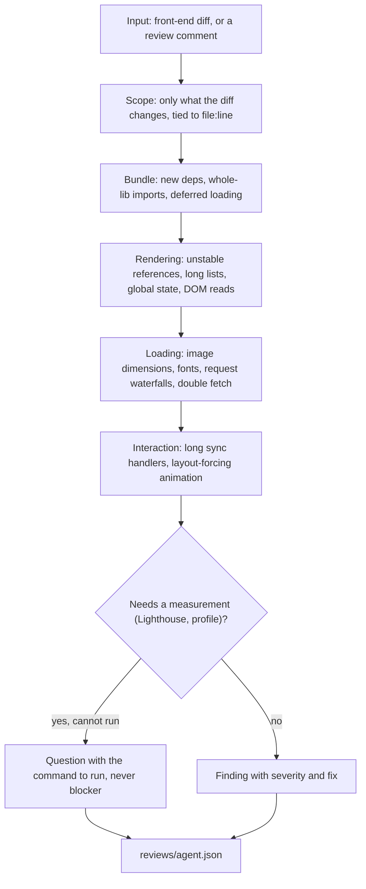
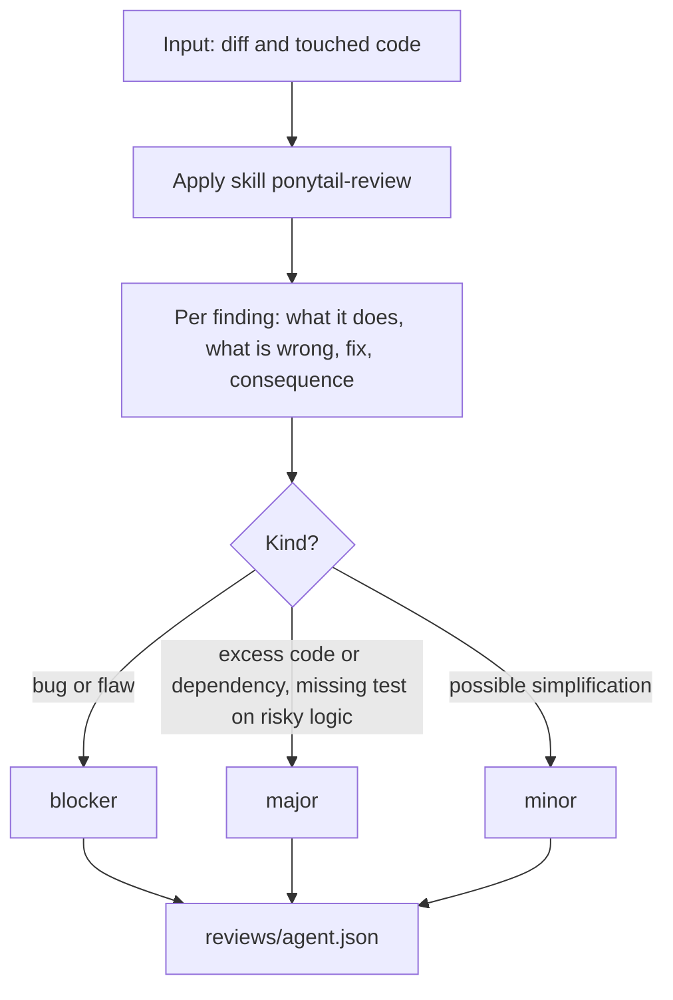
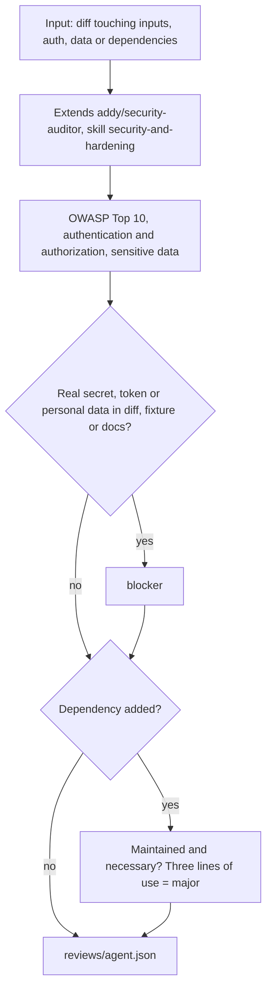
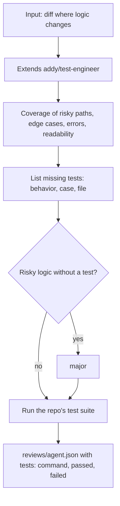

# `agent:review:*`

## `agent:review:api`

## `agent:review:back`

## `agent:review:code`

## `agent:review:front`

## `agent:review:impact`

## `agent:review:mongodb`

## `agent:review:perf`

## `agent:review:ponytail`

## `agent:review:security`

## `agent:review:tests`

